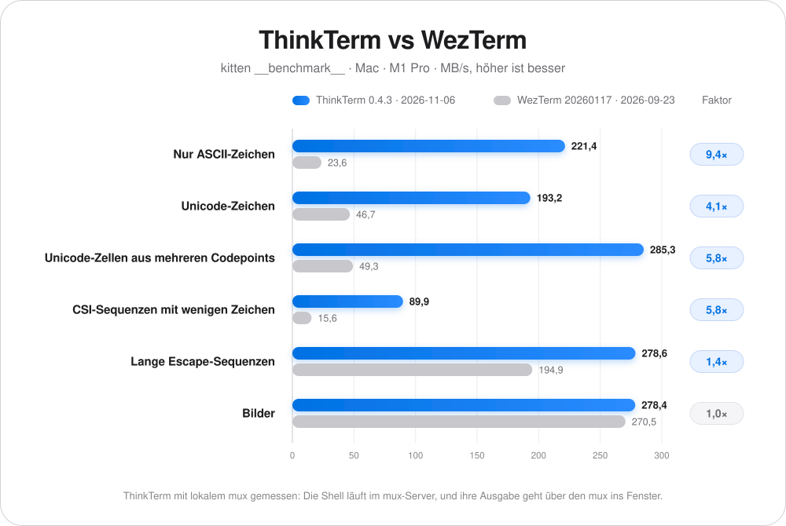
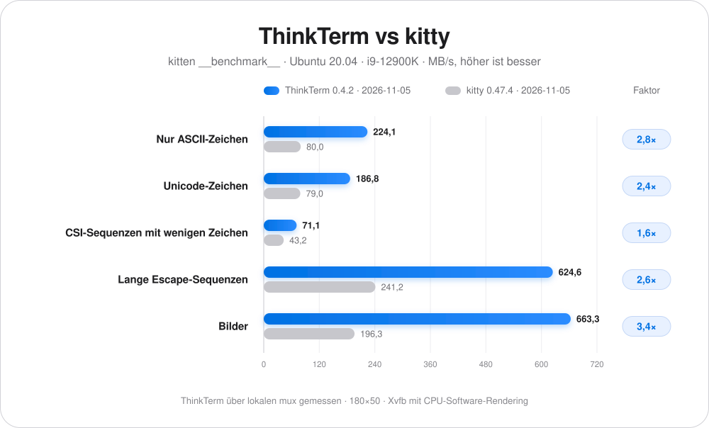
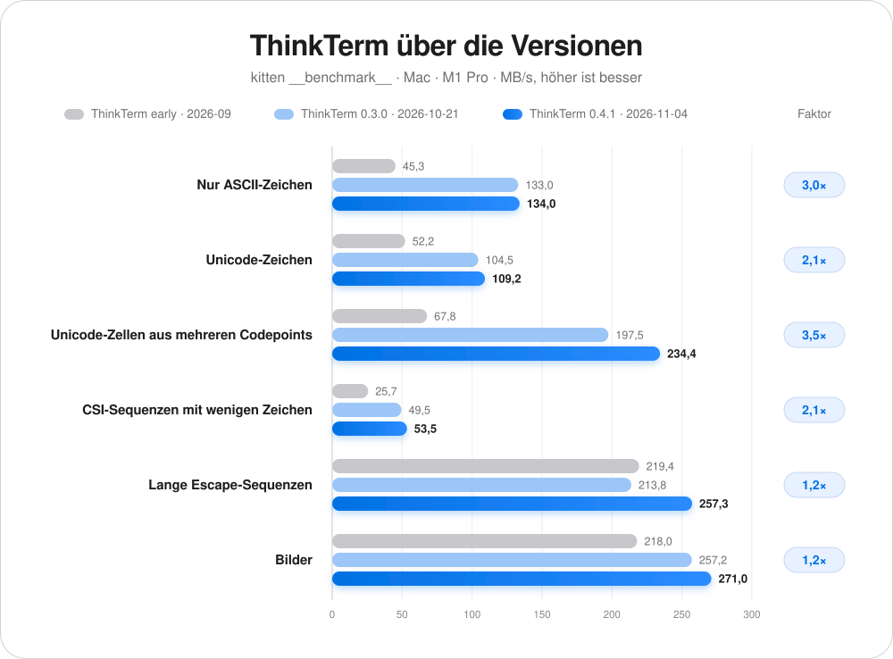

# ThinkTerm

[English](README.md) · [简体中文](README.zh-CN.md) · [日本語](README.ja-JP.md) · [Français](README.fr-FR.md) · **Deutsch**

## 📥 Download

**[Hier herunterladen](https://github.com/RoversX/ThinkTerm/releases)** - Die neueste Version erhalten

🍺 **Homebrew** (macOS): 
```
brew install --cask roversx/tap/thinkterm
```

🌐 **Website**: [closex.org/thinkterm](https://closex.org/thinkterm/)

📚 **Dokumentation**: [docs.closex.org/thinkterm](https://docs.closex.org/thinkterm/)

⭐ Gib [ThinkTerm](https://github.com/RoversX/ThinkTerm) gern einen Stern!

**Deine Rechner werden zu einer gemeinsamen Arbeitsumgebung.**

ThinkTerm ist ein **in Rust geschriebenes Open-Source-Terminal mit integriertem Multiplexer** auf Basis von [WezTerm](https://github.com/wezterm/wezterm). Der mux-Server führt deine Shells, Werkzeuge und Coding-Agenten aus; Desktop-, TUI- und Browser-Clients verbinden sich mit diesen Sitzungen. Bringe lokale und entfernte Arbeit in einem Arbeitsbereich zusammen und greife von anderen Geräten darauf zu.

**Plattformen:** macOS · Linux · Windows · Web · TUI — iOS und Android in Entwicklung.

<table>
  <tr>
    <td width="50%" align="center">
      
      <br><strong>Projektarbeitsbereich</strong>
    </td>
    <td width="50%" align="center">
      
      <br><strong>Agenten auf mehreren Rechnern</strong>
    </td>
  </tr>
  <tr>
    <td width="50%" align="center">
      
      <br><strong>Sitzungsübersicht</strong>
    </td>
    <td width="50%" align="center">
      
      <br><strong>Spaces</strong>
    </td>
  </tr>
</table>

## Der Multiplexer als Kern

<p align="center">
  <picture>
    <source media="(prefers-color-scheme: dark)" srcset="assets/architecture-dark.svg">
    
  </picture>
</p>

Ein Terminal-Multiplexer verwaltet mehrere Terminalsitzungen, mit denen sich Clients verbinden können. In ThinkTerm **hält der mux-Server die Sitzungen, Tabs und geteilten Terminalbereiche**. Der Client zeigt sie an und überträgt deine Eingaben.

- **Trennen und zurückkehren.** Wenn du einen Client trennst, laufen die Sitzungen auf dem Server weiter. Verbinde dich später erneut, um dieselbe Shell, denselben Build oder dieselbe Agentenaufgabe fortzusetzen. Einen Terminalbereich ausdrücklich zu schließen ist eine separate Aktion.
- **Dieselben Sitzungen über verschiedene Clients nutzen.** Verbinde dich per Desktop, `thinkterm tui` oder Browser mit dem Server. Mehrere Clients können gleichzeitig verbunden sein und über ihre jeweilige Oberfläche auf die gemeinsamen Sitzungen zugreifen.
- **Auf mehreren Rechnern arbeiten.** Jeder Host betreibt seinen eigenen mux-Server. ThinkTerm Connect zeigt entfernte Arbeitsbereiche neben der lokalen Arbeit in der Desktop-Anwendung an, sodass du über die Seitenleiste zwischen Rechnern wechselst. Die Prozesse laufen weiterhin auf ihrem ursprünglichen Host.
- **Aktualisieren, ohne Sitzungen zu verlieren.** Wenn der Desktop ThinkTerm auf einem Server aktualisiert, übergibt der laufende mux-Server seine Sitzungen an die neue Version – Shells, Builds und Agenten laufen weiter.

Die Sitzungen bleiben nur bestehen, solange mux-Server und Host verfügbar sind. Laufende Prozesse werden nach einem Server- oder Rechnerneustart nicht wiederhergestellt.

## Warum ThinkTerm

Wenn mehrere Agenten in unterschiedlichen Projekten laufen, wird die Tab-Leiste schnell unübersichtlich: Welche Sitzung arbeitet noch, welche wartet auf eine Eingabe, und wo ist gerade der Build fertig geworden? ThinkTerm zeigt die Projektstruktur und den Arbeitsstatus direkt neben dem Terminal und bringt lokale und entfernte Arbeit zusammen.

Rust bildet die Grundlage für den Terminalkern, den mux-Server, den Desktop-Client und die TUI von ThinkTerm. Die Desktop-Anwendung rendert über die GPU, ohne Electron oder eingebettete WebView. GPUI, das UI-Framework von Zed, erfüllt die Leistungsanforderungen von ThinkTerm an das Terminal-Rendering nicht. Auf der nativen Basis von WezTerm ergänzt ThinkTerm Arbeitsbereiche, dauerhafte Remote-Sitzungen und Werkzeuge für die Arbeit mit Agenten.

## Leistung

Durchsatz im Vergleich zu WezTerm, gemessen mit `kitten __benchmark__` aus kitty auf demselben Mac (MB/s, höher ist besser).

ThinkTerm wurde mit lokalem mux gemessen: Die Shell läuft im mux-Server, und ihre Ausgabe geht über den mux, bevor sie das Fenster erreicht.

<p align="center">
  <picture>
    <source media="(prefers-color-scheme: dark)" srcset="assets/performance-de-DE-dark.svg">
    
  </picture>
</p>

<details>
<summary>Daten als Tabelle</summary>

| Test | ThinkTerm 0.4.2<br>2026-11-05 | WezTerm 20260117-154428-05343b38<br>2026-09-23 | Faktor |
| --- | ---: | ---: | ---: |
| Nur ASCII-Zeichen | **206,1** | 23,6 | 8,7× |
| Unicode-Zeichen | **192,4** | 46,7 | 4,1× |
| Unicode-Zellen aus mehreren Codepoints | **200,9** | 49,3 | 4,1× |
| CSI-Sequenzen mit wenigen Zeichen | **90,9** | 15,6 | 5,8× |
| Lange Escape-Sequenzen | **219,3** | 194,9 | 1,1× |
| Bilder | 216,4 | **270,5** | 0,80× |

</details>

Unter Linux im Vergleich zu kitty auf Ubuntu 20.04 (i9-12900K), bei 180×50 mit `TERM=xterm-256color`, in Xvfb mit CPU-Software-Rendering. ThinkTerm lief auch hier über den lokalen mux.

<p align="center">
  <picture>
    <source media="(prefers-color-scheme: dark)" srcset="assets/performance-linux-de-DE-dark.svg">
    
  </picture>
</p>

<details>
<summary>Daten als Tabelle</summary>

| Test | ThinkTerm 143b60a2<br>2026-10-02 | kitty 0.47.4<br>2026-10-02 | Faktor |
| --- | ---: | ---: | ---: |
| Nur ASCII-Zeichen | **147,4** | 79,4 | 1,9× |
| Unicode-Zeichen | **85,6** | 78,7 | 1,1× |
| CSI-Sequenzen mit wenigen Zeichen | **50,0** | 44,0 | 1,1× |
| Lange Escape-Sequenzen | **533,5** | 238,1 | 2,2× |
| Bilder | **391,8** | 181,0 | 2,2× |

</details>

Fortschritt über die Versionen auf demselben Mac. Der Faktor vergleicht 0.4.2 mit dem frühen Build.

<p align="center">
  <picture>
    <source media="(prefers-color-scheme: dark)" srcset="assets/performance-progress-de-DE-dark.svg">
    
  </picture>
</p>

<details>
<summary>Daten als Tabelle</summary>

| Test | ThinkTerm früh<br>2026-09 | ThinkTerm 0.3.0<br>2026-10-21 | ThinkTerm 0.4.1<br>2026-11-04 | ThinkTerm 0.4.2<br>2026-11-05 | Faktor |
| --- | ---: | ---: | ---: | ---: | ---: |
| Nur ASCII-Zeichen | 45,3 | 133,0 | 134,0 | **206,1** | 4,5× |
| Unicode-Zeichen | 52,2 | 104,5 | 109,2 | **192,4** | 3,7× |
| Unicode-Zellen aus mehreren Codepoints | 67,8 | 197,5 | 234,4 | **200,9** | 3,0× |
| CSI-Sequenzen mit wenigen Zeichen | 25,7 | 49,5 | 53,5 | **90,9** | 3,5× |
| Lange Escape-Sequenzen | 219,4 | 213,8 | 257,3 | **219,3** | 1,00× |
| Bilder | 218,0 | 257,2 | 271,0 | **216,4** | 0,99× |

</details>

## Arbeitsbereiche passend zu deiner Arbeit

| Ebene | Zweck |
| --- | --- |
| **Space** | Ein Arbeitskontext für lokale Arbeit, eine entfernte mux-Verbindung oder einen Notiz-Vault. |
| **Project** | Ein Projektverzeichnis innerhalb dieses Kontexts. |
| **Thread** | Eine Sitzung mit Tabs und geteilten Terminalbereichen; lässt sich anheften oder als ungelesen markieren. |

Lokale und entfernte Arbeitsbereiche teilen sich eine Seitenleiste. Der Thread-Status unterscheidet laufende Arbeit, Aufgaben mit Handlungsbedarf, abgeschlossene Arbeit und inaktive Sitzungen. Die Übersicht zeigt nach Space gruppierte Live-Vorschauen der Terminals, damit du eine Sitzung findest, ohne jeden Tab zu öffnen.

## Für die tägliche Terminalarbeit

- **Rust, Leistung und Speichereffizienz.** ThinkTerm ist für anspruchsvolle Terminalarbeit ausgelegt. Terminaldurchsatz, Rendering-Effizienz und Speicherbedarf werden fortlaufend optimiert, damit viele parallel arbeitende Sitzungen und Agenten möglichst reaktionsschnell bedienbar bleiben.
- **Agentenstatus.** Das Agents-Panel zeigt erkannte Coding-Agenten mit ihrem Arbeitsstatus und Projektkontext in einer Liste. Agentenerkennung und Panel lassen sich in den Einstellungen deaktivieren.
- **Remote-Sitzungen.** Wähle SSH, Mosh oder dauerhafte mux-Sitzungen über ThinkTerm Connect. Entfernte mux-Sitzungen unterstützen Tabs, geteilte Terminalbereiche, Größenänderungen und erneutes Verbinden. Vorausschauendes lokales Echo kann bei langsamen Verbindungen die wahrgenommene Eingabeverzögerung verringern. Hat ein Server noch kein ThinkTerm, bietet die Verbindung an, es unter deinem Benutzerkonto zu installieren, ohne root; einem Server mit einer anderen Version wird die passende angeboten.
- **Integriertes Tailscale.** Tritt deinem Tailnet direkt aus ThinkTerm bei und erreiche seine Rechner ohne die Tailscale-App; sie erscheinen unter den Remote-Hosts neben deinen gespeicherten Servern. Verfügbar für macOS und Linux.
- **Dateien neben dem Terminal.** Durchsuche Projektdateien, sieh dir Quelltext mit Syntaxhervorhebung an und öffne Dateien in einem externen Editor. Der entfernte Dateizugriff erfolgt per SFTP, mit Uploads, Downloads und Übertragung per Drag-and-drop.
- **Notizen.** Bearbeite Markdown in einem Obsidian-kompatiblen Vault, mit Tabellen, Codeblöcken und automatischem Speichern. Die Dateien bleiben gewöhnliche Markdown-Dateien in einem Verzeichnis deiner Wahl.
- **Snippets und Plugins.** Snippets ist integriert. Plugins können der Seitenleiste auf dem Desktop und im Browser weitere Panels hinzufügen. Das Repository enthält ein [Diff-Plugin](plugins/diff), das Git-Änderungen im Repository des benachbarten Terminals anzeigt. Mit dem [ThinkTerm SDK](docs/thinkterm/plugins.md#rust-sdk) kannst du eigene Plugins in Rust entwickeln. Plugins anderer findest du unter dem GitHub-Topic [`thinkterm-plugin`](https://github.com/topics/thinkterm-plugin). Einrichtung und Entwicklung beschreibt die [Plugin-Anleitung](docs/thinkterm/plugins.md).
- **Ein leistungsfähiger Terminalkern.** Ligaturen, farbige Emojis, Echtfarben, Hyperlinks, eingebettete Bilder, Kopiermodus und Shell-Integration stammen aus WezTerm. Weitere Terminalfunktionen findest du in der [Funktionsübersicht von WezTerm](https://wezterm.org/features.html).
- **Native Desktop-Einstellungen.** Passe Themes, Schriftgrößen der Oberfläche, Terminaloptionen und das Rendering-Backend an. Haupt- und Einstellungsfenster unterstützen WebGPU und OpenGL; schlägt die Initialisierung von WebGPU fehl, wird auf OpenGL zurückgegriffen.
- **Fünf Oberflächensprachen.** English, 简体中文, 日本語, Français und Deutsch.

Über die CLI lassen sich Terminalbereiche auch automatisieren: `thinkterm cli send-text` sendet Eingaben, `send-key` drückt Tasten, `get-text` liest Terminalausgaben, und `wait` und `events` melden, wenn ein Befehl endet oder in einem Terminalbereich etwas passiert. Mit `set-pane-label` benannte Terminalbereiche lassen sich über ihren Namen ansprechen. Agenten können diese Befehle nutzen, um über ihre Terminals zusammenzuarbeiten. Die [Notizen zur Zusammenarbeit](docs/thinkterm/agent-collaboration.md) beschreiben den demonstrierten Ablauf und die Grenzen von Terminaleingaben als Nachrichtenmechanismus.

## Wähle deinen Zugang

| Client | Aktueller Umfang |
| --- | --- |
| **Desktop** | Native Anwendung für macOS, Linux und Windows. |
| **TUI** | Navigation durch Arbeitsbereiche und Steuerung von Sitzungen in einem vorhandenen Terminal über `thinkterm tui`. |
| **Browser** | Wird von deinem eigenen mux-Server bereitgestellt; benötigt WebGPU und einen sicheren Browserkontext. Der Browserzugriff muss ausdrücklich aktiviert werden. |
| **iOS und Android** | Native Clients in Entwicklung mit gemeinsamem Rust-Kern, GPU-Rendering und SSH-Transport. Die Vorbereitung auf eine Veröffentlichung und die Geräteprüfung laufen noch. |

Die Clients verbinden sich mit Sitzungen auf dem Server; ihre Oberflächen und ihr Funktionsumfang unterscheiden sich.

### Terminaloberfläche

```sh
thinkterm tui
thinkterm tui --help
```

Die TUI unterstützt die Navigation durch Arbeitsbereiche, Tabs, geteilte Terminalbereiche, Größenänderungen, Kopiermodus und Mausbedienung. Beim Beenden wird die Verbindung getrennt, ohne die Sitzungen auf dem Server zu schließen. Starte sie in einem separaten Terminal: Innerhalb einer ThinkTerm-Sitzung kann der Schutz vor verschachtelten Sitzungen greifen.

### Browserzugriff

Aktiviere einen Listener unter **Settings → Web** und erstelle anschließend ein Zugriffstoken für den Browser. Der mux-Server stellt den Client und seine Ressourcen bereit. Verbindungen außerhalb der Loopback-Schnittstelle erfordern standardmäßig HTTPS; auch WebGPU benötigt einen sicheren Browserkontext.

Die Anleitung zum [Browserzugriff](docs/thinkterm/web-access.md) beschreibt Listener, Tokens, SSH-Weiterleitung und den Umgang mit Zertifikaten.

### Mobile Entwicklung

Die Apps für [iOS](ios) und [Android](android) verwenden native Oberflächen und den gemeinsamen [mobilen Kern](thinkterm-mobile). Sie verbinden sich per SSH mit Sitzungen auf einem anderen Rechner. Sie befinden sich in aktiver Entwicklung und werden hier nicht als bereits veröffentlichte mobile Produkte angeboten.

## Erste Schritte

Für einen Desktop-Build unter macOS oder Linux installierst du Rust und die Build-Werkzeuge deiner Plattform und führst dann Folgendes aus:

```sh
git clone --recursive https://github.com/RoversX/ThinkTerm.git
cd ThinkTerm
./get-deps
cargo build --release -p wezterm -p wezterm-gui -p wezterm-mux-server -p thinkterm-plugin-server -p thinkterm-tailnet-node
```

Die ausführbaren Dateien liegen anschließend unter `target/release`. Quellcodestruktur und Entwicklungsablauf stehen im [Leitfaden für Beiträge](CONTRIBUTING.md). Das [Web-Build-Skript](ci/build-web.sh) erstellt die separaten Web-Ressourcen. Die mobilen Builds starten über [ios/build.sh](ios/build.sh) und [android/build.sh](android/build.sh).

Sobald die ausführbaren Dateien in deinem `PATH` liegen:

```sh
thinkterm start              # Desktop-Anwendung öffnen
thinkterm tui                # Terminaloberfläche öffnen
thinkterm connect <name>     # Mit einer konfigurierten mux-Domain verbinden
thinkterm cli --help         # mux-Sitzungen prüfen und steuern
thinkterm plugin list        # Verfügbare Plugins auflisten
thinkterm --help             # Alle Befehle anzeigen
```

### Coding-Agenten ThinkTerm nutzen lassen

Das Repository enthält einen Skill, mit dem Coding-Agenten wie Claude Code, Codex und Cursor die anderen Terminalbereiche sehen und bedienen können. Installation:

```sh
npx skills add RoversX/ThinkTerm --skill thinkterm -g
```

## Dokumentation und Entwicklung

- [Browserzugriff](docs/thinkterm/web-access.md)
- [Plugins](docs/thinkterm/plugins.md)
- [Mitwirken](CONTRIBUTING.md)

## Konfiguration und Datenschutz

ThinkTerm wird über Lua konfiguriert, verwendet standardmäßig eigene ThinkTerm-Pfade und unterstützt viele WezTerm-Optionen. Unter **Settings → Compatibility** lassen sich ausgewählte Felder aus einer vorhandenen WezTerm-Konfiguration importieren. Eine andere Datei kann auch ausdrücklich angegeben werden, etwa über `THINKTERM_CONFIG_FILE` oder die Kompatibilitätsvariable `WEZTERM_CONFIG_FILE`.

### ThinkTerm verwendet keinerlei Telemetrie oder Tracker

Die Suche nach Updates lässt sich mit `check_for_updates = false` abschalten. Funktionen wie Remote-Verbindungen und das Laden von Bildern in Notizen senden bei ihrer Nutzung Netzwerkanfragen. Entfernte Bilder in Notizen können mit `note_remote_images_enabled = false` deaktiviert werden.

Das SSH-Hostverzeichnis der Desktop-Anwendung verschlüsselt gespeicherte Passwörter mit einem lokal abgelegten Schlüssel. Wer sowohl den Schlüssel als auch die verschlüsselten Hostdaten besitzt, beispielsweise aus einem Backup, kann die Passwörter entschlüsseln. Browser-Zugriffstokens erlauben den Zugriff auf die Terminalsitzungen des Servers und müssen wie Zugangsdaten behandelt werden.

Die Datenschutzerklärung und Informationen zu Browserdaten stehen in [PRIVACY.md](PRIVACY.md).

## Danksagung

- Vielen Dank an **[@wez](https://github.com/wez/) und die Mitwirkenden von [WezTerm](https://github.com/wezterm/wezterm)** für den Terminalkern und die Multiplexer-Grundlagen, auf denen ThinkTerm aufbaut, einschließlich Terminalemulation, Schrift- und GPU-Darstellung sowie SSH-Unterstützung.
- Vielen Dank an die **Mitwirkenden von [herdr](https://github.com/herdrdev/herdr)** für die von ThinkTerm verwendeten Manifeste zur Agentenerkennung.
- Vielen Dank an **Lucide, Simple Icons, Lobe Icons und material-icon-theme** für ihre Icons.
- Vielen Dank an alle, die zu **ThinkTerm** mit Code, Übersetzungen, Tests, Fehlerberichten und Feedback beitragen.

Beiträge sind willkommen. Bitte lies [CONTRIBUTING.md](CONTRIBUTING.md), bevor du einen Pull Request öffnest.

## Lizenz

ThinkTerm steht unter **GPL-3.0-only** — siehe [LICENSE.md](LICENSE.md). Aus WezTerm übernommener Code behält seine ursprüngliche MIT-Lizenz in [LICENSE-MIT](LICENSE-MIT). Die Manifeste zur Agentenerkennung aus herdr stehen unter **Apache-2.0**.

Die vollständigen Quellenangaben und Lizenzen der Drittanbieterkomponenten und mitgelieferten Ressourcen stehen in [NOTICE](NOTICE) und [licenses/README.md](licenses/README.md).


