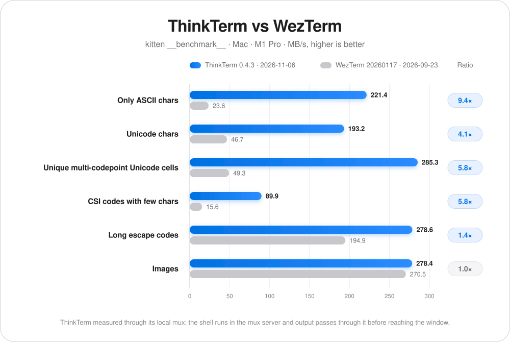
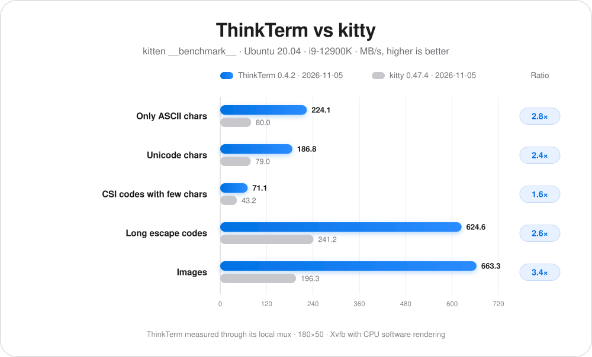
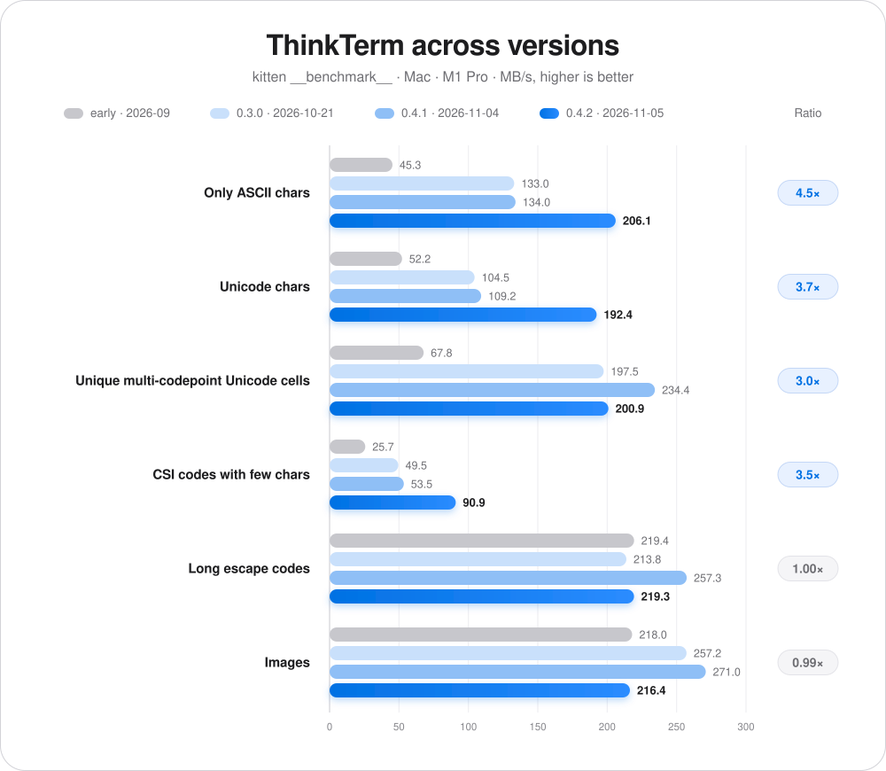

# ThinkTerm

**English** · [简体中文](README.zh-CN.md) · [日本語](README.ja-JP.md) · [Français](README.fr-FR.md) · [Deutsch](README.de-DE.md)

## 📥 Download

**[Download here](https://github.com/RoversX/ThinkTerm/releases)** - Get the latest release

🍺 **Homebrew** (macOS): 
```
brew install --cask roversx/tap/thinkterm
```

🌐 **Website**: [closex.org/thinkterm](https://closex.org/thinkterm/)

📚 **Documentation**: [docs.closex.org/thinkterm](https://docs.closex.org/thinkterm/)

⭐ Consider starring [ThinkTerm](https://github.com/RoversX/ThinkTerm)!

**Your machines fuse into one.**

ThinkTerm is an open-source **terminal with a built-in multiplexer, written in Rust**, built on [WezTerm](https://github.com/wezterm/wezterm). Its mux server runs your shells, tools, and coding agents; desktop, TUI, and browser clients connect to those sessions. Bring local and remote work into one workspace, and return to it from another device.

**Platforms:** macOS · Linux · Windows · Web · TUI — iOS and Android in development.

https://github.com/user-attachments/assets/7317e369-db86-463f-9379-a8a2ed4b602b

<table>
  <tr>
    <td width="50%" align="center">
      
      <br><strong>Project workspace</strong>
    </td>
    <td width="50%" align="center">
      
      <br><strong>Agents across machines</strong>
    </td>
  </tr>
  <tr>
    <td width="50%" align="center">
      
      <br><strong>Session overview</strong>
    </td>
    <td width="50%" align="center">
      
      <br><strong>Spaces</strong>
    </td>
  </tr>
</table>

## A multiplexer at the core

<p align="center">
  <picture>
    <source media="(prefers-color-scheme: dark)" srcset="assets/architecture-dark.svg">
    
  </picture>
</p>

A terminal multiplexer manages multiple terminal sessions and lets clients attach to them. In ThinkTerm, **the mux server owns the sessions, tabs, and split panes**. The client displays them and sends your input.

- **Detach and return.** Disconnecting a client leaves its server-held sessions running. Reconnect later to continue the same shell, build, or agent task. Explicitly closing a pane is a separate action.
- **Access the same sessions from different clients.** Use the desktop, `thinkterm tui`, or the browser to connect to the server. Multiple clients can be attached at once; each offers its own interface to the shared sessions.
- **Work across machines.** Each host runs its own mux server. ThinkTerm Connect brings those remote workspaces into the desktop alongside local work, so you can switch machines from the sidebar. Processes continue to run on their original host.
- **Update without dropping sessions.** When the desktop updates ThinkTerm on a server, the running mux server hands its sessions to the new version, so shells, builds, and agents keep running.

Session persistence depends on the mux server and its host remaining available; it does not restore running processes after a server restart or host reboot.

## Why ThinkTerm

Running several agents across different projects quickly turns a tab bar into a guessing game: which session is working, which needs input, and where did that build finish? ThinkTerm puts the project structure and work status beside the terminal, with local and remote work visible together.

Rust powers ThinkTerm's terminal core, mux server, desktop client, and TUI. The desktop renders through the GPU without Electron or an embedded web view. GPUI, Zed's UI framework, does not meet ThinkTerm's performance requirements for terminal rendering. Built on WezTerm, this native foundation supports workspace organization, persistent remote sessions, and tools for working alongside agents.

## Performance

Throughput compared with WezTerm, measured with kitty's `kitten __benchmark__` on the same Mac (MB/s, higher is better).

ThinkTerm was measured with its local mux: the shell runs in the mux server, and its output passes through the mux before it reaches the window.

<p align="center">
  <picture>
    <source media="(prefers-color-scheme: dark)" srcset="assets/performance-dark.svg">
    
  </picture>
</p>

<details>
<summary>Table data</summary>

| Workload | ThinkTerm 0.4.2<br>2026-11-05 | WezTerm 20260117-154428-05343b38<br>2026-09-23 | Ratio |
| --- | ---: | ---: | ---: |
| Only ASCII chars | **206.1** | 23.6 | 8.7× |
| Unicode chars | **192.4** | 46.7 | 4.1× |
| Unique multi-codepoint Unicode cells | **200.9** | 49.3 | 4.1× |
| CSI codes with few chars | **90.9** | 15.6 | 5.8× |
| Long escape codes | **219.3** | 194.9 | 1.1× |
| Images | 216.4 | **270.5** | 0.80× |

</details>

On Linux, compared with kitty on Ubuntu 20.04 (i9-12900K), at 180×50 with `TERM=xterm-256color`, in Xvfb with CPU software rendering. ThinkTerm again ran through its local mux.

<p align="center">
  <picture>
    <source media="(prefers-color-scheme: dark)" srcset="assets/performance-linux-dark.svg">
    
  </picture>
</p>

<details>
<summary>Table data</summary>

| Workload | ThinkTerm 143b60a2<br>2026-10-02 | kitty 0.47.4<br>2026-10-02 | Ratio |
| --- | ---: | ---: | ---: |
| Only ASCII chars | **147.4** | 79.4 | 1.9× |
| Unicode chars | **85.6** | 78.7 | 1.1× |
| CSI codes with few chars | **50.0** | 44.0 | 1.1× |
| Long escape codes | **533.5** | 238.1 | 2.2× |
| Images | **391.8** | 181.0 | 2.2× |

</details>

Progress across versions on the same Mac. Ratio compares 0.4.2 with the early build.

<p align="center">
  <picture>
    <source media="(prefers-color-scheme: dark)" srcset="assets/performance-progress-dark.svg">
    
  </picture>
</p>

<details>
<summary>Table data</summary>

| Workload | ThinkTerm early<br>2026-09 | ThinkTerm 0.3.0<br>2026-10-21 | ThinkTerm 0.4.1<br>2026-11-04 | ThinkTerm 0.4.2<br>2026-11-05 | Ratio |
| --- | ---: | ---: | ---: | ---: | ---: |
| Only ASCII chars | 45.3 | 133.0 | 134.0 | **206.1** | 4.5× |
| Unicode chars | 52.2 | 104.5 | 109.2 | **192.4** | 3.7× |
| Unique multi-codepoint Unicode cells | 67.8 | 197.5 | 234.4 | **200.9** | 3.0× |
| CSI codes with few chars | 25.7 | 49.5 | 53.5 | **90.9** | 3.5× |
| Long escape codes | 219.4 | 213.8 | 257.3 | **219.3** | 1.00× |
| Images | 218.0 | 257.2 | 271.0 | **216.4** | 0.99× |

</details>

## Workspaces that follow your work

| Layer | Purpose |
| --- | --- |
| **Space** | A working context for local work, a remote mux connection, or a notes Vault. |
| **Project** | A project directory within that context. |
| **Thread** | A session with tabs and split panes; pin it or mark it unread. |

Local and remote workspaces share the sidebar. Thread status helps distinguish running work, work needing attention, completed work, and idle sessions. The overview displays live terminal previews grouped by Space, so you can find a session without opening every tab.

## Built for daily terminal work

- **Rust, performance, and memory efficiency.** ThinkTerm is built for demanding terminal workflows. Terminal throughput, rendering efficiency, and memory use are ongoing optimization priorities, with the goal of keeping many sessions and agents responsive as they work in parallel.
- **Agent status.** The Agents panel brings recognized coding agents into one list with their work status and project context. Agent detection and the panel can be disabled in settings.
- **Remote sessions.** Choose SSH, Mosh, or persistent mux sessions through ThinkTerm Connect. Remote mux sessions support tabs, splits, resizing, and reconnecting. Predictive local echo can reduce perceived typing latency on slower connections. If a server does not have ThinkTerm yet, connecting offers to install it under your user account, no root needed; a server on a different version is offered the matching one.
- **Built-in Tailscale.** Join your tailnet from ThinkTerm and reach its machines without the Tailscale app; they appear in Remote Hosts beside your saved servers. Available on macOS and Linux.
- **Files beside the terminal.** Browse project files, preview source with syntax highlighting, and open files in an external editor. Remote file access uses SFTP, with uploads, downloads, and drag-and-drop transfers.
- **Notes.** Work with Markdown in an Obsidian-compatible Vault, including tables, code blocks, and autosave. The files remain ordinary Markdown in a directory you choose.
- **Snippets and plugins.** Snippets is built in. Plugins can add sidebar panels to the desktop and browser; the repository includes a [Diff plugin](plugins/diff) for inspecting the adjacent terminal's Git changes. Build your own plugins in Rust with the [ThinkTerm SDK](docs/thinkterm/plugins.md#rust-sdk). Find plugins others share under the GitHub topic [`thinkterm-plugin`](https://github.com/topics/thinkterm-plugin). See the [plugin guide](docs/thinkterm/plugins.md) for setup and development.
- **A capable terminal core.** Ligatures, color emoji, true color, hyperlinks, inline images, copy mode, and shell integration come from WezTerm. See the [WezTerm feature reference](https://wezterm.org/features.html) for more terminal capabilities.
- **Native desktop settings.** Adjust themes, UI font sizes, terminal options, and the renderer. Both the main window and settings support WebGPU and OpenGL, with an OpenGL fallback if WebGPU initialization fails.
- **Five interface languages.** English, 简体中文, 日本語, Français, and Deutsch.

The CLI also exposes panes to automation: `thinkterm cli send-text` sends input, `send-key` presses keys, `get-text` reads terminal output, and `wait` and `events` report when a command finishes or something happens in a pane. Label a pane with `set-pane-label` to address it by name. Agents can use these commands to interact through their terminals. The [collaboration notes](docs/thinkterm/agent-collaboration.md) describe the demonstrated workflow and the limits of terminal input as a messaging mechanism.

## Choose how you connect

| Client | Current scope |
| --- | --- |
| **Desktop** | Native application for macOS, Linux, and Windows. |
| **TUI** | Workspace navigation and terminal control inside an existing terminal, through `thinkterm tui`. |
| **Browser** | A client served by your own mux server; requires WebGPU and a secure browser context. Browser access must be enabled explicitly. |
| **iOS and Android** | Native clients in development, with a shared Rust core, GPU rendering, and SSH transport. Mobile release readiness and device coverage are still being established. |

The clients connect to server-held sessions; their interfaces and feature coverage differ.

### Terminal interface

```sh
thinkterm tui
thinkterm tui --help
```

The TUI supports workspace navigation, tabs, splits, resizing, copy mode, and mouse input. Exiting detaches from the server without closing its sessions. Run it from a separate terminal; launching it inside ThinkTerm's own session can trigger the nested-session guard.

### Browser access

Enable a listener in **Settings → Web**, then create an access token for the browser. The mux server serves the client and its assets. Connections away from loopback require HTTPS by default; the browser also needs a secure context to expose WebGPU.

See [Browser access](docs/thinkterm/web-access.md) for listener setup, tokens, SSH forwarding, and certificate handling.

### Mobile development

The [iOS](ios) and [Android](android) apps use native interfaces and the shared [mobile core](thinkterm-mobile). They connect over SSH to sessions on another machine. They are under active development and are not presented here as released mobile products.

## Getting started

For a desktop build on macOS or Linux, install Rust and your platform's build tools, then:

```sh
git clone --recursive https://github.com/RoversX/ThinkTerm.git
cd ThinkTerm
./get-deps
cargo build --release -p wezterm -p wezterm-gui -p wezterm-mux-server -p thinkterm-plugin-server -p thinkterm-tailnet-node
```

The binaries are written to `target/release`. See [Contributing](CONTRIBUTING.md) for the source layout and development workflow. The [browser build script](ci/build-web.sh) builds the separate Web assets; mobile build entry points are [ios/build.sh](ios/build.sh) and [android/build.sh](android/build.sh).

Once the binaries are on your `PATH`:

```sh
thinkterm start              # Open the desktop application
thinkterm tui                # Open the terminal interface
thinkterm connect <name>     # Attach to a configured mux domain
thinkterm cli --help         # Inspect and control mux sessions
thinkterm plugin list        # List available plugins
thinkterm --help             # Show all commands
```

### Let your coding agent use ThinkTerm

The repository includes a skill that teaches coding agents such as Claude Code, Codex and Cursor to see and work with the other panes. Install it with:

```sh
npx skills add RoversX/ThinkTerm --skill thinkterm -g
```

## Documentation and development

- [Browser access](docs/thinkterm/web-access.md)
- [Plugins](docs/thinkterm/plugins.md)
- [Contributing](CONTRIBUTING.md)

## Configuration and privacy

ThinkTerm uses Lua configuration with its own default ThinkTerm paths and supports many WezTerm options. **Settings → Compatibility** can import selected fields from an existing WezTerm configuration. Explicit file overrides, including `THINKTERM_CONFIG_FILE` and the compatibility variable `WEZTERM_CONFIG_FILE`, can select another file.

### ThinkTerm uses no telemetry or trackers

Update checks can be disabled with `check_for_updates = false`. Features such as remote connections and loading images in Notes make network requests when used; remote Note images can be disabled with `note_remote_images_enabled = false`.

The desktop SSH host book encrypts saved passwords with a locally stored key. Anyone with both the key and encrypted host data, including in a backup, can decrypt the passwords. Browser access tokens grant access to the server's terminal sessions and should be treated as credentials.

See [PRIVACY.md](PRIVACY.md) for the privacy policy and browser data handling.

## Acknowledgments

- Thank you to **[@wez](https://github.com/wez/) and the [WezTerm](https://github.com/wezterm/wezterm) contributors** for the terminal core and multiplexer foundations on which ThinkTerm is built, including terminal emulation, font and GPU rendering, and SSH support.
- Thank you to the **[herdr](https://github.com/herdrdev/herdr) contributors** for the agent detection manifests used by ThinkTerm.
- Thank you to **Lucide, Simple Icons, Lobe Icons, and material-icon-theme** for their icon resources.
- Thank you to everyone contributing code, translations, testing, bug reports, and feedback to **ThinkTerm**.

Contributions are welcome. Please read [CONTRIBUTING.md](CONTRIBUTING.md) before opening a pull request.

## License

ThinkTerm is licensed under **GPL-3.0-only** — see [LICENSE.md](LICENSE.md). Code originating from WezTerm retains its original MIT license in [LICENSE-MIT](LICENSE-MIT). The agent detection manifests from herdr are licensed under **Apache-2.0**.

See [NOTICE](NOTICE) and [licenses/README.md](licenses/README.md) for the full third-party attributions and licenses of bundled components and assets.


