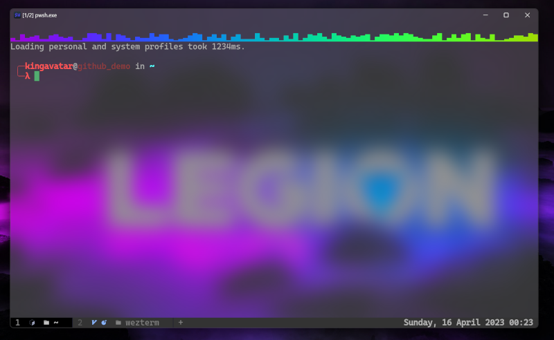
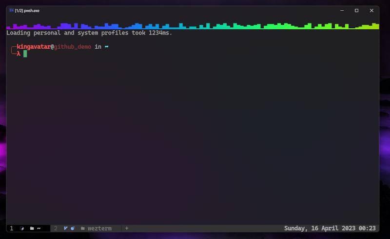
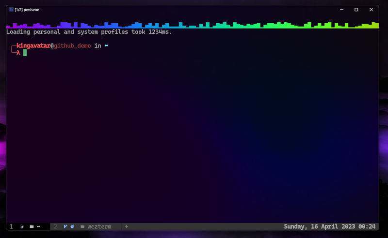

---
tags:
  - appearance
---

# `win32_system_backdrop = SETTING`

{{since('20230712-072601-f4abf8fd')}}

When combined with `window_background_opacity`, chooses from available
window background effects provided by Windows.

The possible values for `win32_system_backdrop` are:

* `"Auto"` - the default. A see-through window gets *Acrylic*; an opaque one gets no backdrop. On Windows 11 22H2 and later this is the system *Desktop Acrylic* material; on Windows 10 1809 and later it falls back to the legacy acrylic accent policy, which is not part of the public API and may be a no-op or lag on some builds.
* `"Disable"` - disable backdrop effects. A see-through window then shows what is behind it sharply.
* `"Acrylic"` - enable the *Acrylic* blur-behind-window effect. It is real-time blur of the desktop and the other windows behind the terminal.
* `"Mica"` - enable the *Mica* effect, available on Windows 11 build 22621 and later. Mica is **opaque**: it is derived from the desktop wallpaper and does not blur other windows behind the terminal.
* `"Tabbed"` - enable the *Mica Alt* effect, available on Windows 11 build 22621 and later. It is also opaque.

On Windows 11 22H2 and later, *Acrylic* is `DWMSBT_TRANSIENTWINDOW` from the
documented `DwmSetWindowAttribute` system backdrop API. On earlier systems
ThinkTerm asks for the legacy acrylic accent policy; that path is best-effort.

On Windows systems earlier than build 22621, the *Acrylic* effect can be
adjusted using [win32_acrylic_accent_color](win32_acrylic_accent_color.md).
More recent versions of Windows do not permit configuring the accent color
for *Acrylic*, so that option has no effect there.

The *Acrylic* setting uses more resources than the others. Windows disables
system acrylic when *Transparency effects* is off in Settings, when Battery
Saver is on, and in other cases where it falls back to a solid colour. On
Windows 11 the material also becomes solid while the window is not focused;
that is the system's behaviour, not a ThinkTerm fallback.

Set `window_background_opacity` lower than `1.0` for the *Acrylic* effect to
show. `0` gives the strongest blur but removes the terminal's own tint;
`0.5`–`0.8` usually keeps the text readable. *Mica* and *Tabbed* are opaque,
so their appearance does not depend on the window opacity in the same way.

See also [macos_window_background_blur](macos_window_background_blur.md) for
a similar effect on macOS.

See also [kde_window_background_blur](kde_window_background_blur.md) for a similar
effect on KDE Wayland.

## Acrylic

```lua
config.window_background_opacity = 0.8
config.win32_system_backdrop = 'Acrylic'
```



## Mica

```lua
config.window_background_opacity = 0
config.win32_system_backdrop = 'Mica'
```



## Tabbed

```lua
config.window_background_opacity = 0
config.win32_system_backdrop = 'Tabbed'
```




