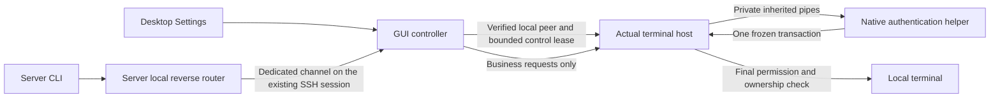

# Connect reverse access: implementation

The [user guide](connect-reverse-access.md) describes the product workflow and platform requirements.
This maintainer reference records the security contract, the implementation, and how to reproduce
the SSH exchange tests.

## Review contract

Reverse access covers four operations over an existing ThinkTerm Connect connection: list,
plain-text read, text input, and key input. Ordinary SSH/Mosh, third-device relays, subscriptions,
`--wait`, and rich-text output do not enter this capability. Existing local and desktop-to-server
permissions remain independent. Password-only SSH eligibility is a product rule, not a claim
that passwords are safer than keys; authentication preference and host verification must not
be weakened to make a connection eligible.

Treat remote messages, terminal titles, labels, and ordinary local CLI/plugin/configuration
calls as untrusted approval sources. Programs under the approved server account can consume
the grant; it does not isolate individual agents. The application boundary does not resist
reading trusted process memory, replacing trusted executables, or controlling the OS. That
exclusion does not permit a public API to create, extend, or approve grants.

The implementation and any follow-up must preserve these properties:

- Only a native authentication result for a frozen, one-use intent can create or renew a grant.
  Settings, Lua, plugins, ordinary RPC, and remote data requests cannot submit approval success.
  Authentication occurs in a local native window, never in a remotely readable terminal.
- Connection eligibility, user consent, and final execution checks remain separate. A pane ID,
  label, process ID, socket path, configuration flag, or `from_desktop` field is not authority.
- The actual terminal host checks target lifetime, owner, grant version, permission, expiry,
  and revocation at execution and before releasing each part of a response. No implicit claim,
  viewport takeover, or palette/layout change accompanies delegated input.
- All-local membership may change only within the explicitly approved host, route, and scope.
  Membership changes cannot extend expiry or widen a selected-terminal grant.
- Cancellation, expiry, revocation, reconnect, host replacement, and lost monitoring cannot be
  undone by a late callback or status reply. Grants and pending approvals are never persisted
  or transferred through update, handoff, or rollback.
- Length limits, budgets, and total deadlines apply before allocation or enqueueing and remain
  owned until queued data is consumed or cancelled. Slow peers cannot retain unlimited work.
- Hidden and nonexistent targets have indistinguishable access errors. Lists, errors, Debug,
  and exceptional logs must not disclose hidden targets, terminal bodies, input, or credentials.
- Input results describe PTY submission, including partial or unknown outcomes. Input is never
  automatically retried, and revocation cannot recall bytes already accepted by OS buffers.
- A failed request fails that request. Only a channel that no longer works ends the bridge, and
  with it the grants. See "Serial channels" below.

Unavailable or unverifiable authentication, session monitoring, or host identity denies access.
A host the user accepted at the unknown-host prompt counts as verified: that is the same trust
ordinary Connect gives it, and it is a decision the user made on that connection.
Headless servers may request approved desktop access; headless exporting remains unsupported.
System-authentication availability, compilation, and unit tests do not establish native usability.

## Source map

| Area | Sources |
| --- | --- |
| SSH session evidence and exchanges | `wezterm-ssh/src/authentication.rs`, `wezterm-ssh/src/authentication_tests.rs`, and `wezterm-ssh/tests/fixtures/authentication-server.py` |
| Grants, clocks, framing, budgets, local IPC, native supervision | `thinkterm-reverse-access/src/` |
| Native authentication | `thinkterm-reverse-access/native/`, `thinkterm-connect-auth/`, and `ci/build-connect-auth.sh` |
| Actual host and reverse router | `mux/src/connect.rs` and `mux/src/connect/` |
| Connection binding and guarded forwarding | `wezterm-client/src/client.rs` and `wezterm-client/src/connect.rs` |
| GUI and CLI integration | `wezterm-gui/src/connect_access.rs`, `wezterm-gui/src/settings_window/connect_access.rs`, and `wezterm/src/cli/reverse.rs` |
| Final read/input and host lifecycle | `mux/src/localpane.rs`, `mux/src/tab.rs`, `term/src/terminalstate/`, `pty/src/`, and mux-server handoff |

## Implemented path



`wezterm-ssh` records actual authentication evidence in the owning SSH session. The client
constructs a `VerifiedConnectSession` only from complete, host-verified password evidence.
The original session is retained for the dedicated reverse channel and is invalidated when
the normal connection ends. Reconnection requires a new session and approval.

`AuthenticationInfo` is stored in the session's private `OnceLock` before the existing
`SessionEvent::Authenticated` event. It has no serialization or caller-population interface.
It retains backend, host-verification outcome, completeness, and at most 16 successful or
partially successful authentication steps; overflow makes the evidence incomplete. It retains
no secrets, prompt answers, account names, or hostnames and starts no background work.

libssh distinguishes rejected and partially accepted keys. ssh2 cannot always distinguish them
after an earlier failed call, so those sessions remain ineligible even if a later password succeeds.
Keyboard-interactive, none, incomplete evidence, external connection reuse, and unverified hosts
also remain ineligible. Method evidence alone never creates a grant. Cancelling password or
private-key decryption cannot publish completed evidence or fall through to another method.

The actual terminal host owns `Authority`, native monitoring, and the grants. A separate local
admission socket checks kernel-supplied peer identity and the packaged executable path. The
GUI's process identity and mux instance must match the management connection. This is an
admission check, not proof of authentication. Grant creation consumes the host's own native
helper result over inherited pipes. No wire type accepts an authenticated or approved flag.
The control path supports an already running local session host without a readable authority
token file. Replacing trusted executable files or controlling the operating system is outside
the application-level grant boundary.

The normal mux dispatcher exposes only local endpoint discovery; Web, share, and TLS peers
cannot use that discovery operation. Remote reverse channels decode only four business
operations. They cannot call the management commands or trigger native authentication.
Server-account processes may register and consume a router connection, but that registration
does not give them any desktop authority.

Actual local panes are captured with their object, tab membership, client registration,
ownership epoch, and a fresh export incarnation. The final host checks these bindings again
under the relevant locks. A pane number, domain name, or `local_session_host` flag alone cannot
select a permitted terminal. Ownership changes are tracked independently from geometry updates; changing away
from an owner and back does not revive an old export. Removing a pane from its captured tab
invalidates its membership token even if it returns before the next authorization check.
Atomic stack and split moves within the same tab preserve membership. Tokens have a bounded
weak registry, with entries released on removal, tab destruction, or subsequent capture after
the last export drops them. Both individual operations and List transmission check membership.

## Lifetime and execution

The frontend offers connection-wide authorization of all eligible local terminals, including
future terminals. It chooses the active local session host automatically, with in-process
terminals as the fallback when no host is attached. The selected-terminal engine and editor
remain in the source, with the editor disabled by a private build constant. No user-facing
scope toggle was added.

An all-local native intent starts with an empty target set and explicitly describes current and
future terminals. The actual host captures eligible panes after authentication and refreshes
their bounded target set on status and business requests. Existing captures retain their identities;
removed or no-longer-owned panes are dropped, and later eligible captures receive fresh identities.
Only an all-local grant on the exact route and version permits membership replacement. It cannot
change permission, expiry, or the replay watermark. An empty set does not end an all-local grant.
The final GUI output guard also matches each pane's incarnation. A target it does not know yet,
newly added or captured again under the same pane number, waits for a trusted status. A status
requested after the reply arrived settles it: what that status still omits is gone, and the
reply is refused.

The core stores one pending authentication transaction and freezes its route, scope, targets,
permission, duration, renewal version, and deadline. Native callbacks are one-use capabilities
inside the crate. Cancelling a transaction also revokes a result created but not yet delivered
to the controller. Renewal creates a new grant version and preserves the route's replay
watermark. Active grants and authentication callbacks are never persisted.

Explicit revocation uses the route and stable grant ID, covering a renewal that completed
after the UI rendered its button and cancelling a matching pending native renewal. Cleanup
of an old grant object remains version-specific so it cannot revoke a successful replacement.

Linux uses `CLOCK_BOOTTIME`; macOS uses `CLOCK_MONOTONIC_RAW`; Windows uses its QPC-backed
`Instant`. These platform choices include sleep, while a generic cross-platform assumption
about `Instant` is deliberately avoided. All deadlines use checked arithmetic and fail closed
on clock errors or reversal. Remaining request time is reduced at each forwarding stage and
the outer request deadline remains active; forwarding cannot restart an unrestricted ten-second
operation. A supplied remaining duration never extends the host's grant deadline.

Native monitor and GUI-control leases expire within five seconds. The monitor sends one
heartbeat per second and cannot revive a missed lease. The GUI's final SSH-send guard uses
conservative host status with a shorter four-second lease, anchored before requesting that
status. Explicit GUI revocation invalidates this guard immediately and cannot be undone by
a stale status reply. Replies naming new or renewed grants wait for a trusted control status
before their first byte is written; they cannot approve themselves. Synchronization preserves
the original request deadline, grant expiration, and control lease. Every partial write still
checks the current guard. Host events propagate through the control channel; revocation does not
claim to recall bytes already accepted by an OS or SSH buffer.

Read conversion is bounded while iterating terminal cells. Plain text is held with its request
reservation, and the host rechecks permission and target identity at each outgoing partial
write. GUI forwarding also checks its conservative output guard at each nonblocking poll.
Host locks are only ever tried. `Busy` means an attempt did no work, so every step that can meet
it, from a list row's title through building a snapshot, encoding input and queueing it, yields
and retries under the request deadline. A terminal with heavy output is held often, and a list
covers every terminal, so failing on `Busy` would let one busy terminal fail commands for all of
them. Retries preserve the current frame offset and repeat authorization checks; revocation,
target loss, clock failure, and expiry still stop the send. Rate and budget limits are not
contention: they are answered with `Failed(Busy)` straight away.

## Serial channels

The router-to-GUI and GUI-to-host channels carry one exchange at a time, so a request's reply is
the only thing that puts them back in step. Three rules follow.

- Every request is answered. A refusal or failure is `Reply::Failed`, and input refused on arrival
  still has its blocks read off the channel. `exchange.rs` keeps the two outcomes apart: its outer
  `Result` is the channel's, the inner one the request's.
- Time is kept back for the answer. `REPLY_MARGIN` comes off the deadline at each forwarding stage:
  router, GUI, then the host's own work, which leaves the host's operation about 8.5 of the ten
  seconds. Input that outlasts it is cancelled and its partial result still delivered. A read that
  outlasts it stops between blocks. List and read permits run to the reply's deadline rather than
  the operation's, so that the frame being written when the operation ends can finish.
- A sender that cannot continue between blocks sends `Kind::Cancel` for that sequence. The router
  turns it into `Failed(Unavailable)`. The GUI does the same when its output guard refuses partway,
  and when the host's operation ends with blocks still to forward, then reads the host's remaining
  blocks without forwarding them. On a slow connection those queued blocks would otherwise outlast
  the GUI's own deadline, and draining them as the host stops lets the host finish its frame.

Once a request is on the channel the router runs the exchange to its reply, even if the requester
has gone, and drops the result. It waits up to 15 seconds past the request's deadline for that
reply, since a reply the desktop sent in time can still be in a slow connection's buffers; a
desktop silent for longer has lost the channel. A reply's bytes grow the request's own reservation,
so it needs no second slot or rate charge. If the bytes do not fit, the text is read off the
channel and the requester gets `Failed(Busy)`.

What still ends a bridge: transport loss, a protocol violation, a frame abandoned partway through
its bytes (a guard failing during one partial write), and a peer that stays silent. The first
three need no recovery, and all four fail closed. A connection too slow to carry one block within
`REPLY_MARGIN`, or to empty its buffers within `LATE_REPLY`, reaches the last two during a long
read.

Reverse target resolution treats every locally claimed label or thread alias as a collision,
including names shared by several panes. Local listing failures propagate to the caller instead
of being interpreted as proof that no local target exists.

Delegated input uses the existing ordered terminal writer queue, but carries a final-check
closure instead of an already authorized byte buffer. Each nonblocking PTY write rechecks
the grant, target, owner, and deadline. Text and optional Enter stay in one queue operation,
written separately with `enter_delay` between them, the same wait the ordinary CLI path uses.
The checks repeat throughout that wait, and ordinary input to that pane queues behind it.
Cancellation releases the queued payload immediately; its concurrency slot remains owned
until the queue drains, preventing repeated cancelled work from growing an unlimited queue.
Results distinguish not submitted, fully submitted, partial, and unknown outcomes. Bracketed
paste cancellation reports a potentially open paste rather than writing after revocation.

Unix and ConPTY input adapters support bounded nonblocking submission. Ordinary terminal writes
retain their blocking behavior and handle partial writes. Handoff first closes the old Connect
authority and quiesces its input handles before transferring PTY descriptors. Old handles stay
invalid, including after rollback, and dropping one cannot change the successor's descriptor
mode. Rollback may create new handles and new grants through a new controller.

## Limits and release points

| Resource | Bound and ownership |
| --- | --- |
| Routes, grants, target references | At most 16 routes and 64 grants; one all-local grant per route with at most 256 targets; selected-terminal grants retain the 32-per-grant and 256-total limits; route/authority destruction releases them |
| Business request | Ten-second total deadline; no transparent input retry |
| Frame | 32 KiB including header, no compression; five-second total partial-frame deadline |
| Payload block | 16 KiB; ordered offsets and total lengths checked before assembly |
| Read / text / keys | 2,000 physical lines and 1 MiB / 64 KiB / 64 keys |
| In-flight work | Process budget 32 slots and 32 MiB; route budget 8 slots and 8 MiB; channel reservations also consume these limits |
| Rate | Process 40 requests/s with burst 80; route 10/s with burst 20 |
| Read output | Process 8 MiB/s and route 2 MiB/s token budgets |
| Local admissions | Eight pending handshakes, with further clients left in the listen queue until one finishes; bounded route queues; sockets are private, removed on shutdown, and swept by the next service if a process exited without unwinding |
| Native work | One authentication attempt, 120-second timeout, bounded intent/event pipes; helper reaped on completion or cancellation |

These are ceilings, not a promise that every maximum can be reached simultaneously. Buffer,
queue, frame, and response ownership retain reservations until consumption or cancellation.
A slow or departed CLI loses its own connection, and its reply is dropped. Closing
the mux also closes the service and active handlers. With no editor or grant, the feature
does not scan panes, start native helpers, or open a dedicated SSH channel.

## Platform implementation and packaging

| Platform | Implementation |
| --- | --- |
| macOS | Swift/AppKit helper with no window of its own: the system dialog's reason states the access, duration, and server. Fresh `LAContext`, native device-owner policy, zero configured Touch ID reuse, console checks and session/lock/sleep observation |
| Windows | Rust helper: system task dialog, window-associated Hello, system credential prompt with `LogonUser` for the current local account and a SID comparison, session and power notifications |
| Linux | Rust helper, fixed PAM service, actual secret prompt plus account checks, Zenity, logind and screensaver monitoring with pinned service owner |

All three helpers show the words `text.rs` gives them, chosen by the host from the frozen intent.
The Windows and Linux helpers confirm the scope in a window of their own first. On macOS the
Settings button is that step and the system dialog is the only window, so its reason has to carry
everything, with the source last so that a long one cannot push the rest out of view.
The GUI names a language on the management connection, which only selects a translation, so no
caller can make the window describe less than is being granted.

Linux rejects remote X displays, constrains Wayland and D-Bus to the actual user's protected
local runtime directory, and requires an unambiguous active graphical session. System policy
and Zenity must be root-owned and protected from group/other writes. No caller-selected PAM
service or direct `unix_chkpwd` invocation is used. Headless requesting works without desktop
authentication; creating headless exports remains explicitly unsupported.

The macOS bundle includes the Swift helper alongside executables. Windows installer/portable
packages include `thinkterm-connect-auth.exe`, a Rust binary of a few megabytes built with the
rest of the workspace, which replaced a .NET helper that added about 150 MB to every Windows
package. Linux desktop packages install the helper, Zenity/PAM dependencies, and the matching
policy; portable packages carry policy files and instructions. Release scripts include Linux
helper binaries and macOS universal helper assembly.

The Linux desktop tarball installer retains `share/thinkterm/connect-auth` under the chosen
prefix, including the PAM templates and instructions. It does not install the system PAM
policy itself. Older desktop archives without these optional assets remain installable.

The Windows helper, `thinkterm-connect-auth/src/win.rs`, is the one place this feature uses
`unsafe`, agreed for that file alone: Hello, the credential prompt, and the task dialog exist
only as system calls. Everywhere else, including the crate's other platforms, it stays
forbidden. The Windows dialog needs common controls 6, which `windows.manifest` requests; the
helper does not load without it. Anything that ends an attempt there, such as a closed control
pipe, a session change, or the deadline, ends the process, so no result can be reported after it.

The credential buffers these helpers own are cleared, but the system's prompt and PAM keep their
own, which prevents a universal complete-erasure claim. The helpers are short-lived and do not
log or send credentials to the requester.

Other Unix targets retain a compiling IPC implementation that rejects peer admission as
unavailable. Reverse access is unsupported there; the library dependency does not require
macOS/Linux-only peer variables in ordinary FreeBSD or NetBSD builds.

## Development builds

Build the Rust binaries first, then install the native companion beside them. On macOS, `cargo build --workspace` alone leaves a stub in its place.
Do not replace an installed app or attach the test build to existing terminal sessions.

| Development target | Companion build after the Rust build |
| --- | --- |
| macOS arm64 | `bash ci/build-connect-auth.sh macos arm64 target/debug` |
| macOS x86_64 | `bash ci/build-connect-auth.sh macos x86_64 target/debug` |
| Windows | `cargo build -p thinkterm-connect-auth` |
| Linux | `cargo build -p thinkterm-connect-auth`, plus administrator installation of the matching PAM policy and Zenity as described in the user guide |

Use the actual target/profile directory instead of `target/debug` for cross or `dist` builds.
For macOS app-bundle testing, place the helper in `Contents/MacOS`; running the CLI or mux server
from another directory requires its companion there as well.

## Reproduce the SSH exchange tests

The required workspace suite excludes `wezterm-ssh`, so run its library tests separately for
both backends. Two partial-success tests are ignored by default: the russh 0.63.3 fixture clears
the partial-success flag in the relevant rejection paths, so they use the independent Paramiko
server in `wezterm-ssh/tests/fixtures/authentication-server.py`. It handles one loopback exchange,
has a bounded lifetime, and never reads actual OS accounts, configuration, or user keys.

From the repository root, use a disposable environment and keep the existing Cargo caches:

```sh
check_root=$(mktemp -d /tmp/tt-connect-check.XXXXXX)
mkdir -p "$check_root/home" "$check_root/run"
python3 -m venv "$check_root/python"
"$check_root/python/bin/python" -m pip --isolated install --no-cache-dir 'paramiko==5.1.0'
for backend in libssh-rs ssh2; do
  env -u SSH_AUTH_SOCK -u SSH_AGENT_PID \
    HOME="$check_root/home" \
    CARGO_HOME="${CARGO_HOME:-$HOME/.cargo}" \
    RUSTUP_HOME="${RUSTUP_HOME:-$HOME/.rustup}" \
    XDG_CONFIG_HOME="$check_root/config" XDG_CACHE_HOME="$check_root/cache" \
    XDG_DATA_HOME="$check_root/data" XDG_RUNTIME_DIR="$check_root/run" \
    THINKTERM_AUTH_TEST_PYTHON="$check_root/python/bin/python" \
    cargo test -p wezterm-ssh --no-default-features --features "$backend" --lib -- --include-ignored
done
```

The exchange fixtures currently run on Unix and need loopback socket permission. Key-decryption
cancellation also needs `ssh-keygen`, operating only on a disposable test identity. Paramiko is
a test dependency, not a packaged runtime dependency. A passing suite without `--include-ignored`
does not establish the two partial-success cases.

## API references

- [SSH authentication and partial success](https://www.rfc-editor.org/rfc/rfc4252.html#section-5.1)
- [SSH keyboard-interactive](https://www.rfc-editor.org/rfc/rfc4256.html)
- [Apple device-owner authentication](https://developer.apple.com/documentation/localauthentication/lapolicy/deviceownerauthentication)
- [Apple continuous time and CLOCK_MONOTONIC_RAW](https://developer.apple.com/documentation/kernel/1646199-mach_continuous_time)
- [Windows high-resolution time stamps](https://learn.microsoft.com/en-us/windows/win32/sysinfo/acquiring-high-resolution-time-stamps)
- [Windows desktop verification interop](https://learn.microsoft.com/en-us/windows/win32/api/userconsentverifierinterop/nf-userconsentverifierinterop-iuserconsentverifierinterop-requestverificationforwindowasync)
- [Linux PAM conversation](https://man7.org/linux/man-pages/man3/pam_conv.3.html)
- [Linux CLOCK_BOOTTIME](https://man7.org/linux/man-pages/man2/clock_gettime.2.html)
