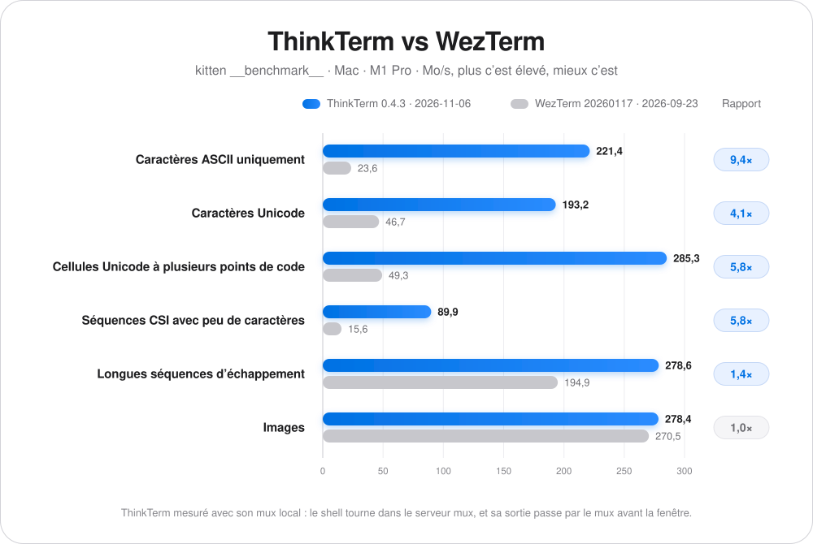
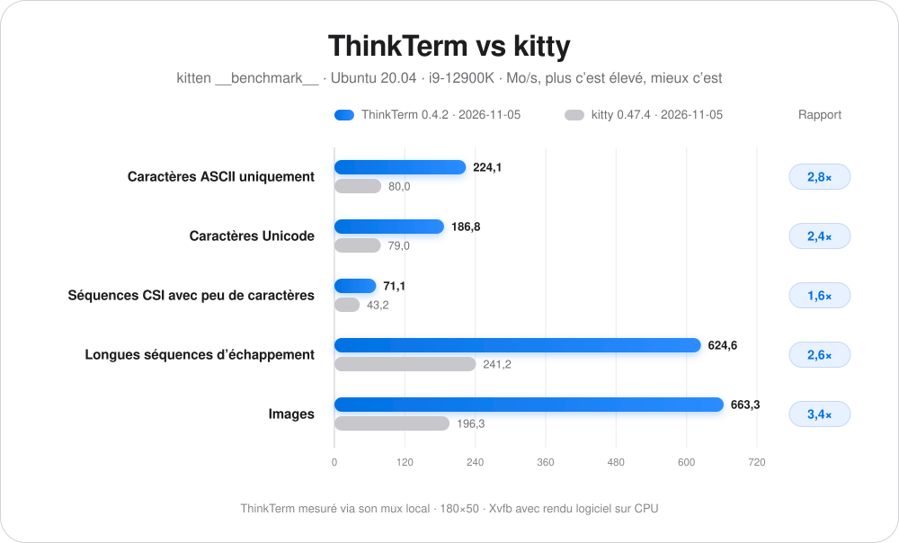
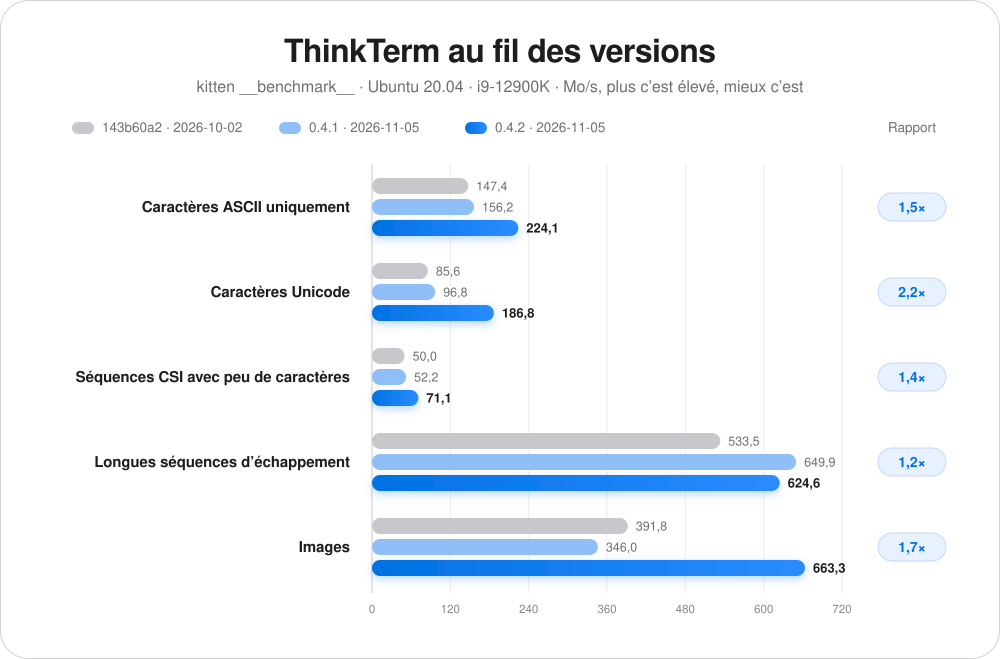

# ThinkTerm

[English](../README.md) · [简体中文](README.zh-CN.md) · [日本語](README.ja-JP.md) · **Français** · [Deutsch](README.de-DE.md)

## 📥 Téléchargement

**[Télécharger ici](https://github.com/RoversX/ThinkTerm/releases)** - Obtenir la dernière version

🍺 **Homebrew** (macOS) : 
```
brew install --cask roversx/tap/thinkterm
```

🌐 **Site web**: [closex.org/thinkterm](https://closex.org/thinkterm/)

📚 **Documentation**: [docs.closex.org/thinkterm](https://docs.closex.org/thinkterm/)

⭐ Pensez à ajouter une étoile à [ThinkTerm](https://github.com/RoversX/ThinkTerm) !

**Vos machines réunies dans un même espace de travail.**

ThinkTerm est un **terminal open source avec multiplexeur intégré, écrit en Rust**, fondé sur [WezTerm](https://github.com/wezterm/wezterm). Son serveur mux exécute vos shells, vos outils et vos agents de programmation ; les clients de bureau, TUI et navigateur se connectent à ces sessions. Réunissez le travail local et distant dans un même espace, accessible depuis un autre appareil.

**Plateformes :** macOS · Linux · Windows · Web · TUI — iOS et Android en développement.

<table>
  <tr>
    <td width="50%" align="center">
      
      <br><strong>Espace de travail du projet</strong>
    </td>
    <td width="50%" align="center">
      
      <br><strong>Agents sur plusieurs machines</strong>
    </td>
  </tr>
  <tr>
    <td width="50%" align="center">
      
      <br><strong>Vue d’ensemble des sessions</strong>
    </td>
    <td width="50%" align="center">
      
      <br><strong>Espaces</strong>
    </td>
  </tr>
</table>

## Le multiplexeur au cœur de ThinkTerm

<p align="center">
  <picture>
    <source media="(prefers-color-scheme: dark)" srcset="../assets/architecture-dark.svg">
    
  </picture>
</p>

Un multiplexeur de terminaux gère plusieurs sessions et permet aux clients de s’y connecter. Dans ThinkTerm, **le serveur mux conserve les sessions, les onglets et les volets divisés**. Le client les affiche et transmet vos entrées.

- **Se détacher, puis revenir.** Déconnecter un client laisse les sessions du serveur actives. Reconnectez-vous plus tard pour retrouver le même shell, la même compilation ou la même tâche d’agent. Fermer explicitement un volet est une action distincte.
- **Accéder aux mêmes sessions depuis plusieurs clients.** Utilisez le bureau, `thinkterm tui` ou le navigateur pour vous connecter au serveur. Plusieurs clients peuvent être connectés simultanément, chacun offrant sa propre interface aux sessions partagées.
- **Travailler sur plusieurs machines.** Chaque hôte exécute son propre serveur mux. ThinkTerm Connect affiche les espaces distants à côté du travail local dans l’application de bureau, pour passer d’une machine à l’autre depuis la barre latérale. Les processus continuent de s’exécuter sur leur hôte d’origine.
- **Mettre à jour sans couper les sessions.** Quand le bureau met à jour ThinkTerm sur un serveur, le serveur mux en cours transmet ses sessions à la nouvelle version : shells, compilations et agents continuent de tourner.

La persistance des sessions dépend de la disponibilité du serveur mux et de son hôte ; elle ne restaure pas les processus après un redémarrage du serveur ou de la machine.

## Pourquoi ThinkTerm

Lorsque plusieurs agents travaillent sur différents projets, la barre d'onglets ne suffit plus : quelle session travaille encore, laquelle attend une réponse et où la compilation vient-elle de se terminer ? ThinkTerm place la structure des projets et leur état à côté du terminal, pour suivre le travail local et distant au même endroit.

Rust est au cœur du terminal, du serveur mux, du client de bureau et de la TUI de ThinkTerm. L’application de bureau utilise le GPU pour le rendu, sans Electron ni WebView intégrée. GPUI, le framework d’interface de Zed, ne répond pas aux exigences de performance de ThinkTerm pour le rendu du terminal. Sur les fondations natives de WezTerm, ThinkTerm ajoute l’organisation en espaces de travail, les sessions distantes persistantes et des outils pour travailler avec des agents.

## Performances

Débit comparé à WezTerm, mesuré avec `kitten __benchmark__` de kitty sur le même Mac (Mo/s, plus c’est élevé, mieux c’est).

ThinkTerm a été mesuré avec son mux local : le shell tourne dans le serveur mux, et sa sortie passe par le mux avant d’arriver dans la fenêtre.

<p align="center">
  <picture>
    <source media="(prefers-color-scheme: dark)" srcset="../assets/performance-fr-FR-dark.svg">
    
  </picture>
</p>

<details>
<summary>Données en tableau</summary>

| Test | ThinkTerm 0.4.7<br>2026-11-08 | WezTerm 20260117-154428-05343b38<br>2026-09-23 | Rapport |
| --- | ---: | ---: | ---: |
| Caractères ASCII uniquement | **231,2** | 23,6 | 9,8× |
| Caractères Unicode | **207,5** | 46,7 | 4,4× |
| Cellules Unicode à plusieurs points de code | **307,2** | 49,3 | 6,2× |
| Séquences CSI avec peu de caractères | **89,6** | 15,6 | 5,7× |
| Longues séquences d’échappement | **317,9** | 194,9 | 1,6× |
| Images | **305,8** | 270,5 | 1,1× |

</details>

Sous Linux, comparé à kitty sur Ubuntu 20.04 (i9-12900K), en 180×50 avec `TERM=xterm-256color`, dans Xvfb avec rendu logiciel sur CPU. ThinkTerm passait là aussi par son mux local.

<p align="center">
  <picture>
    <source media="(prefers-color-scheme: dark)" srcset="../assets/performance-linux-fr-FR-dark.svg">
    
  </picture>
</p>

<details>
<summary>Données en tableau</summary>

| Test | ThinkTerm 0.4.2<br>2026-11-05 | kitty 0.47.4<br>2026-11-05 | Rapport |
| --- | ---: | ---: | ---: |
| Caractères ASCII uniquement | **224,1** | 80,0 | 2,8× |
| Caractères Unicode | **186,8** | 79,0 | 2,4× |
| Séquences CSI avec peu de caractères | **71,1** | 43,2 | 1,6× |
| Longues séquences d’échappement | **624,6** | 241,2 | 2,6× |
| Images | **663,3** | 196,3 | 3,4× |

</details>

Progression au fil des versions sur le même Mac. Le rapport compare 0.4.3 à la première version.

<p align="center">
  <picture>
    <source media="(prefers-color-scheme: dark)" srcset="../assets/performance-progress-fr-FR-dark.svg">
    
  </picture>
</p>

<details>
<summary>Données en tableau</summary>

| Test | ThinkTerm première version<br>2026-09 | ThinkTerm 0.3.0<br>2026-10-21 | ThinkTerm 0.4.1<br>2026-11-04 | ThinkTerm 0.4.2<br>2026-11-05 | ThinkTerm 0.4.3<br>2026-11-06 | Rapport |
| --- | ---: | ---: | ---: | ---: | ---: | ---: |
| Caractères ASCII uniquement | 45,3 | 133,0 | 134,0 | 206,1 | **221,4** | 4,9× |
| Caractères Unicode | 52,2 | 104,5 | 109,2 | 192,4 | **193,2** | 3,7× |
| Cellules Unicode à plusieurs points de code | 67,8 | 197,5 | 234,4 | 200,9 | **285,3** | 4,2× |
| Séquences CSI avec peu de caractères | 25,7 | 49,5 | 53,5 | 90,9 | **89,9** | 3,5× |
| Longues séquences d’échappement | 219,4 | 213,8 | 257,3 | 219,3 | **278,6** | 1,3× |
| Images | 218,0 | 257,2 | 271,0 | 216,4 | **278,4** | 1,3× |

</details>

Progression au fil des versions sur le même environnement Linux. Le rapport compare 0.4.2 à 143b60a2.

<p align="center">
  <picture>
    <source media="(prefers-color-scheme: dark)" srcset="../assets/performance-linux-progress-fr-FR-dark.svg">
    
  </picture>
</p>

<details>
<summary>Données en tableau</summary>

| Test | ThinkTerm 143b60a2<br>2026-10-02 | ThinkTerm 0.4.1<br>2026-11-05 | ThinkTerm 0.4.2<br>2026-11-05 | Rapport |
| --- | ---: | ---: | ---: | ---: |
| Caractères ASCII uniquement | 147,4 | 156,2 | **224,1** | 1,5× |
| Caractères Unicode | 85,6 | 96,8 | **186,8** | 2,2× |
| Séquences CSI avec peu de caractères | 50,0 | 52,2 | **71,1** | 1,4× |
| Longues séquences d’échappement | 533,5 | 649,9 | **624,6** | 1,2× |
| Images | 391,8 | 346,0 | **663,3** | 1,7× |

</details>

## Des espaces adaptés à votre travail

| Niveau | Rôle |
| --- | --- |
| **Space (espace)** | Un contexte de travail local, une connexion mux distante ou un coffre de notes Vault. |
| **Project (projet)** | Un répertoire de projet dans ce contexte. |
| **Thread (fil)** | Une session avec des onglets et des volets divisés, que vous pouvez épingler ou marquer comme non lue. |

Les espaces locaux et distants partagent la même barre latérale. L'état des Threads permet de distinguer le travail en cours, celui qui demande votre attention, le travail terminé et les sessions inactives. La vue d'ensemble affiche des aperçus de terminaux en direct, regroupés par Space, pour retrouver une session sans ouvrir chaque onglet.

## Pour le travail quotidien dans le terminal

- **Rust, performances et efficacité mémoire.** ThinkTerm est conçu pour les usages intensifs du terminal. Le débit de traitement, l’efficacité du rendu et la consommation mémoire font l’objet d’optimisations continues, afin de préserver la réactivité lorsque de nombreuses sessions et de nombreux agents travaillent en parallèle.
- **État des agents.** Le panneau Agents rassemble les agents de programmation reconnus, leur état et leur projet. La détection et le panneau peuvent être désactivés dans les paramètres.
- **Sessions distantes.** Choisissez SSH, Mosh ou les sessions mux persistantes de ThinkTerm Connect. Les sessions mux distantes prennent en charge les onglets, les volets divisés, le redimensionnement et la reconnexion. L'écho local prédictif peut réduire la latence ressentie à la saisie sur les connexions lentes. Si un serveur n'a pas encore ThinkTerm, la connexion propose de l'installer avec votre compte, sans root ; un serveur dans une autre version se voit proposer la version correspondante.
- **Tailscale intégré.** Rejoignez votre tailnet depuis ThinkTerm et atteignez ses machines sans l'application Tailscale ; elles apparaissent dans les hôtes distants à côté de vos serveurs enregistrés. Disponible sur macOS et Linux.
- **Les fichiers à côté du terminal.** Parcourez les fichiers du projet, prévisualisez le code avec coloration syntaxique et ouvrez-le dans un éditeur externe. L'accès distant utilise SFTP, avec envoi, téléchargement et transfert par glisser-déposer.
- **Notes.** Éditez du Markdown dans un Vault compatible avec Obsidian, avec tableaux, blocs de code et enregistrement automatique. Les fichiers restent de simples fichiers Markdown, dans le répertoire de votre choix.
- **Extraits et plugins.** Snippets est intégré. Les plugins peuvent ajouter des panneaux à la barre latérale, sur le bureau et dans le navigateur. Le dépôt contient un [plugin Diff](../plugins/diff) pour examiner les modifications Git du dépôt utilisé par le terminal voisin. Créez vos propres plugins en Rust avec le [ThinkTerm SDK](../docs/thinkterm/plugins.md#rust-sdk). Trouvez les plugins partagés par d'autres sous le sujet GitHub [`thinkterm-plugin`](https://github.com/topics/thinkterm-plugin). Consultez le [guide des plugins](../docs/thinkterm/plugins.md) pour l'installation et le développement.
- **Un cœur de terminal complet.** Ligatures, emoji en couleur, couleurs 24 bits, hyperliens, images intégrées, mode copie et intégration au shell proviennent de WezTerm. Pour découvrir d’autres fonctions du terminal, consultez la [documentation des fonctionnalités de WezTerm](https://wezterm.org/features.html).
- **Paramètres de bureau natifs.** Réglez les thèmes, la taille du texte de l'interface, les options du terminal et le moteur de rendu. La fenêtre principale et celle des paramètres prennent en charge WebGPU et OpenGL, avec repli vers OpenGL si l'initialisation de WebGPU échoue.
- **Cinq langues d'interface.** English, 简体中文, 日本語, Français et Deutsch.

La CLI permet aussi d'automatiser les volets : `thinkterm cli send-text` envoie des entrées, `send-key` appuie sur des touches, `get-text` lit la sortie du terminal, et `wait` et `events` signalent la fin d'une commande ou ce qui se passe dans un volet. Nommez un volet avec `set-pane-label` pour le désigner par son nom. Les agents peuvent utiliser ces commandes pour interagir par leurs terminaux. Les [notes sur la collaboration](../docs/thinkterm/agent-collaboration.md) décrivent le scénario démontré et les limites de l'entrée terminal comme mécanisme de messagerie.

## Choisir son mode de connexion

| Client | Périmètre actuel |
| --- | --- |
| **Bureau** | Application native pour macOS, Linux et Windows. |
| **TUI** | Navigation dans les espaces et contrôle des sessions depuis un terminal existant, avec `thinkterm tui`. |
| **Navigateur** | Client servi par votre propre serveur mux ; nécessite WebGPU et un contexte sécurisé du navigateur. L'accès doit être activé explicitement. |
| **iOS et Android** | Clients natifs en développement, avec un cœur Rust partagé, un rendu GPU et un transport SSH. La préparation à la publication et la validation sur les appareils se poursuivent. |

Ces clients se connectent aux sessions hébergées par le serveur ; leurs interfaces et leurs fonctionnalités diffèrent.

### Interface en terminal

```sh
thinkterm tui
thinkterm tui --help
```

La TUI prend en charge la navigation dans les espaces, les onglets, les volets divisés, le redimensionnement, le mode copie et la souris. La quitter vous détache du serveur sans fermer ses sessions. Lancez-la depuis un terminal distinct : un lancement au sein d'une session ThinkTerm peut déclencher la protection contre les sessions imbriquées.

### Accès par navigateur

Activez un point d'écoute dans **Settings → Web**, puis créez un jeton d'accès pour le navigateur. Le serveur mux fournit le client et ses ressources. Par défaut, les connexions hors de l'interface de bouclage nécessitent HTTPS ; le navigateur doit également disposer d'un contexte sécurisé pour proposer WebGPU.

Le guide [Accès par navigateur](../docs/thinkterm/web-access.md) détaille les points d'écoute, les jetons, la redirection SSH et la gestion des certificats.

### Développement mobile

Les applications [iOS](../ios) et [Android](../android) utilisent des interfaces natives et un [cœur mobile partagé](../thinkterm-mobile). Elles se connectent par SSH aux sessions d'une autre machine. Leur développement est actif ; elles ne sont pas présentées ici comme des produits mobiles déjà publiés.

## Premiers pas

Pour compiler l'application de bureau sur macOS ou Linux, installez Rust et les outils de compilation de votre plateforme, puis exécutez :

```sh
git clone --recursive https://github.com/RoversX/ThinkTerm.git
cd ThinkTerm
./get-deps
cargo build --release -p wezterm -p wezterm-gui -p wezterm-mux-server -p thinkterm-plugin-server -p thinkterm-tailnet-node
```

Les exécutables sont créés dans `target/release`. Consultez le [guide de contribution](../CONTRIBUTING.md) pour l'organisation du code et le processus de développement. Le [script de compilation web](../ci/build-web.sh) produit les ressources Web séparément ; les points d'entrée mobiles sont [ios/build.sh](../ios/build.sh) et [android/build.sh](../android/build.sh).

Une fois les exécutables ajoutés à votre `PATH` :

```sh
thinkterm start              # Ouvrir l'application de bureau
thinkterm tui                # Ouvrir l'interface en terminal
thinkterm connect <name>     # Se connecter à un domaine mux configuré
thinkterm cli --help         # Examiner et contrôler les sessions mux
thinkterm plugin list        # Lister les plugins disponibles
thinkterm --help             # Afficher toutes les commandes
```

### Laisser votre agent de programmation utiliser ThinkTerm

Le dépôt inclut un skill qui apprend aux agents de programmation comme Claude Code, Codex et Cursor à voir et à piloter les autres volets. Pour l’installer :

```sh
npx skills add RoversX/ThinkTerm --skill thinkterm -g
```

## Documentation et développement

- [Accès par navigateur](../docs/thinkterm/web-access.md)
- [Plugins](../docs/thinkterm/plugins.md)
- [Contribuer](../CONTRIBUTING.md)

## Configuration et confidentialité

ThinkTerm utilise une configuration Lua, avec ses propres chemins par défaut, et prend en charge de nombreuses options de WezTerm. **Settings → Compatibility** permet d'importer les champs choisis d'une configuration WezTerm existante. Un fichier peut aussi être sélectionné explicitement, notamment avec `THINKTERM_CONFIG_FILE` ou la variable de compatibilité `WEZTERM_CONFIG_FILE`.

### ThinkTerm n’utilise aucune télémétrie ni aucun traceur

La recherche de mises à jour peut être désactivée avec `check_for_updates = false`. Les connexions distantes ou le chargement d'images dans les notes effectuent des requêtes réseau lors de leur utilisation ; les images distantes des notes peuvent être désactivées avec `note_remote_images_enabled = false`.

Le carnet d'hôtes SSH de l'application de bureau chiffre les mots de passe avec une clé conservée localement. Toute personne possédant à la fois cette clé et les données chiffrées, y compris dans une sauvegarde, peut déchiffrer les mots de passe. Les jetons d'accès du navigateur donnent accès aux sessions terminal du serveur et doivent être traités comme des identifiants d'accès.

Consultez [PRIVACY.md](../PRIVACY.md) pour la politique de confidentialité et le traitement des données du navigateur.

## Remerciements

- Merci à **[@wez](https://github.com/wez/) et aux contributeurs de [WezTerm](https://github.com/wezterm/wezterm)** pour le cœur du terminal et les fondations du multiplexeur sur lesquels repose ThinkTerm, notamment l’émulation de terminal, le rendu des polices et le rendu GPU, ainsi que la prise en charge de SSH.
- Merci aux **contributeurs de [herdr](https://github.com/herdrdev/herdr)** pour les manifestes de détection des agents utilisés par ThinkTerm.
- Merci à **Lucide, Simple Icons, Lobe Icons et material-icon-theme** pour leurs icônes.
- Merci à toutes les personnes qui contribuent au code, aux traductions, aux tests, aux signalements de bugs et aux retours d’expérience de **ThinkTerm**.

Les contributions sont les bienvenues. Lisez [CONTRIBUTING.md](../CONTRIBUTING.md) avant d’ouvrir une pull request.

## Licence

ThinkTerm est distribué sous **GPL-3.0-only** — voir [LICENSE.md](../LICENSE.md). Le code provenant de WezTerm conserve sa licence MIT d’origine dans [LICENSE-MIT](../LICENSE-MIT). Les manifestes de détection des agents provenant de herdr sont sous licence **Apache-2.0**.

Consultez [NOTICE](../NOTICE) et [licenses/README.md](../licenses/README.md) pour les attributions complètes et les licences des composants tiers et des ressources incluses.


