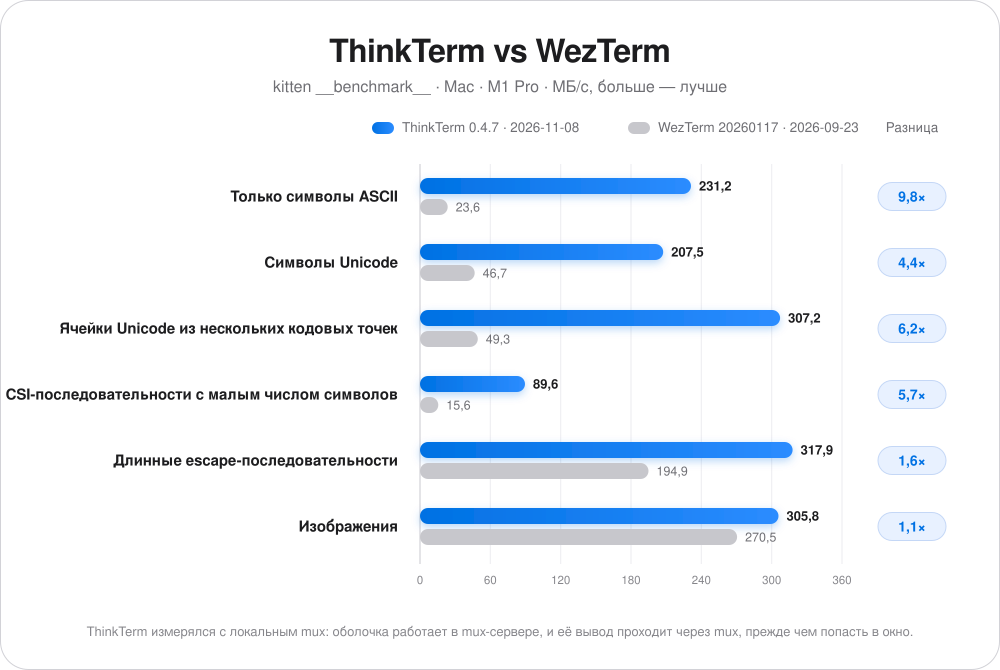
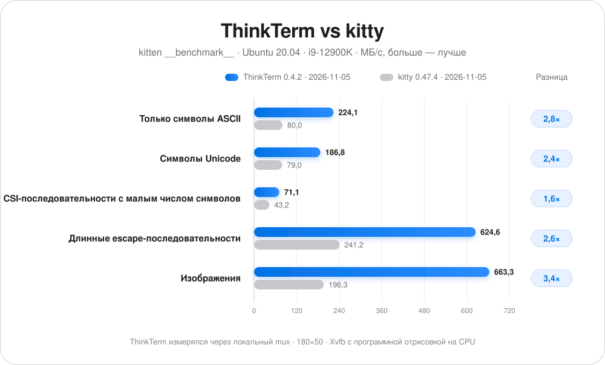
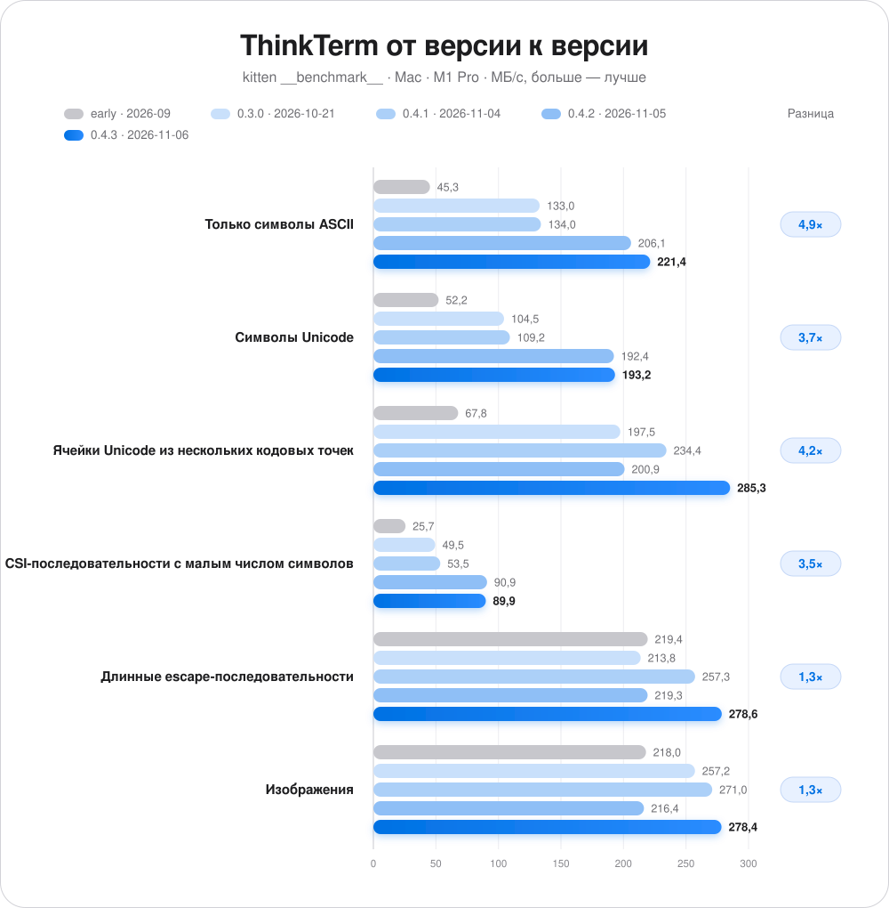
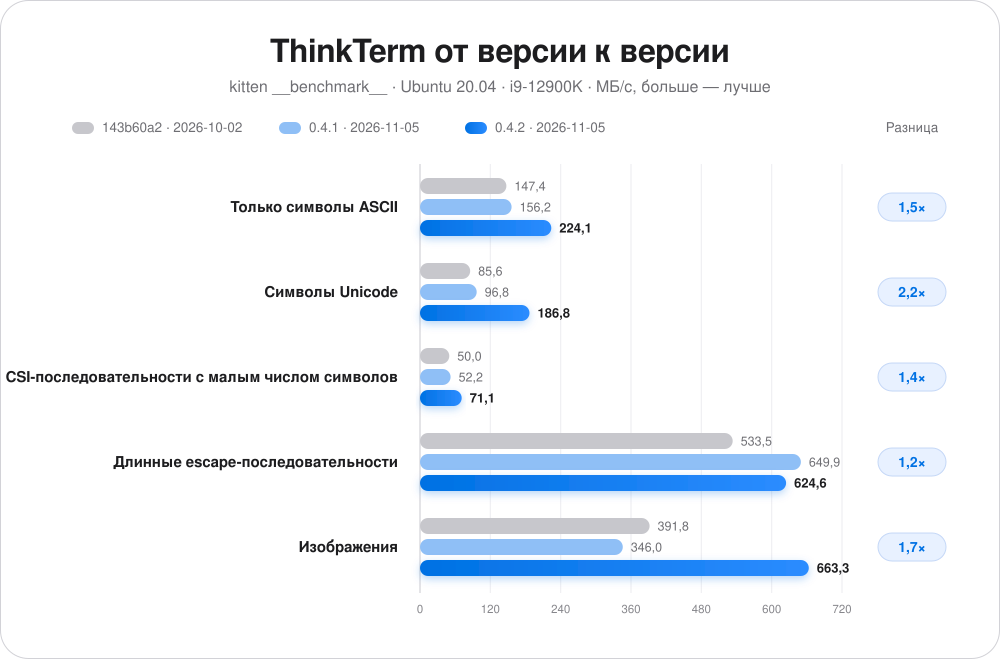

# ThinkTerm

[English](../README.md) · [简体中文](README.zh-CN.md) · [日本語](README.ja-JP.md) · [Français](README.fr-FR.md) · [Deutsch](README.de-DE.md) · **Русский**

## 📥 Загрузка

**[Скачать здесь](https://github.com/RoversX/ThinkTerm/releases)** - последняя версия

🍺 **Homebrew** (macOS): 
```
brew install --cask roversx/tap/thinkterm
```

🌐 **Сайт**: [closex.org/thinkterm](https://closex.org/thinkterm/)

📚 **Документация**: [docs.closex.org/thinkterm](https://docs.closex.org/thinkterm/)

⭐ Поставьте звезду [ThinkTerm](https://github.com/RoversX/ThinkTerm)!

**Ваши машины сливаются в одну.**

ThinkTerm — это **терминал со встроенным мультиплексором, написанный на Rust**, с открытым исходным кодом и построенный на [WezTerm](https://github.com/wezterm/wezterm). Его mux-сервер запускает ваши оболочки, инструменты и агентов для программирования, а настольный клиент, TUI и браузер подключаются к этим сеансам. Соберите локальную и удалённую работу в одном рабочем пространстве и возвращайтесь к ней с другого устройства.

**Платформы:** macOS · Linux · Windows · Web · TUI — iOS и Android в разработке.

https://github.com/user-attachments/assets/7317e369-db86-463f-9379-a8a2ed4b602b

<table>
  <tr>
    <td width="50%" align="center">
      
      <br><strong>Рабочее пространство проекта</strong>
    </td>
    <td width="50%" align="center">
      
      <br><strong>Агенты на разных машинах</strong>
    </td>
  </tr>
  <tr>
    <td width="50%" align="center">
      
      <br><strong>Обзор сеансов</strong>
    </td>
    <td width="50%" align="center">
      
      <br><strong>Spaces</strong>
    </td>
  </tr>
</table>

## Производительность

Пропускная способность в сравнении с WezTerm, измеренная с помощью `kitten __benchmark__` из kitty на одном и том же Mac (МБ/с, больше — лучше).

ThinkTerm измерялся с локальным mux: оболочка работает в mux-сервере, и её вывод проходит через mux, прежде чем попасть в окно.

<p align="center">
  <picture>
    <source media="(prefers-color-scheme: dark)" srcset="../assets/performance-ru-RU-dark.svg">
    
  </picture>
</p>

<details>
<summary>Данные таблицы</summary>

| Тест | ThinkTerm 0.4.7<br>2026-11-08 | WezTerm 20260117-154428-05343b38<br>2026-09-23 | Разница |
| --- | ---: | ---: | ---: |
| Только символы ASCII | **231,2** | 23,6 | 9,8× |
| Символы Unicode | **207,5** | 46,7 | 4,4× |
| Ячейки Unicode из нескольких кодовых точек | **307,2** | 49,3 | 6,2× |
| CSI-последовательности с малым числом символов | **89,6** | 15,6 | 5,7× |
| Длинные escape-последовательности | **317,9** | 194,9 | 1,6× |
| Изображения | **305,8** | 270,5 | 1,1× |

</details>

В Linux — в сравнении с kitty на Ubuntu 20.04 (i9-12900K), при размере 180×50 с `TERM=xterm-256color`, в Xvfb с программной отрисовкой на CPU. ThinkTerm и здесь работал через локальный mux.

<p align="center">
  <picture>
    <source media="(prefers-color-scheme: dark)" srcset="../assets/performance-linux-ru-RU-dark.svg">
    
  </picture>
</p>

<details>
<summary>Данные таблицы</summary>

| Тест | ThinkTerm 0.4.2<br>2026-11-05 | kitty 0.47.4<br>2026-11-05 | Разница |
| --- | ---: | ---: | ---: |
| Только символы ASCII | **224,1** | 80,0 | 2,8× |
| Символы Unicode | **186,8** | 79,0 | 2,4× |
| CSI-последовательности с малым числом символов | **71,1** | 43,2 | 1,6× |
| Длинные escape-последовательности | **624,6** | 241,2 | 2,6× |
| Изображения | **663,3** | 196,3 | 3,4× |

</details>

Прогресс от версии к версии на том же Mac. Разница — 0.4.3 в сравнении с ранней сборкой.

<p align="center">
  <picture>
    <source media="(prefers-color-scheme: dark)" srcset="../assets/performance-progress-ru-RU-dark.svg">
    
  </picture>
</p>

<details>
<summary>Данные таблицы</summary>

| Тест | ThinkTerm, ранняя сборка<br>2026-09 | ThinkTerm 0.3.0<br>2026-10-21 | ThinkTerm 0.4.1<br>2026-11-04 | ThinkTerm 0.4.2<br>2026-11-05 | ThinkTerm 0.4.3<br>2026-11-06 | Разница |
| --- | ---: | ---: | ---: | ---: | ---: | ---: |
| Только символы ASCII | 45,3 | 133,0 | 134,0 | 206,1 | **221,4** | 4,9× |
| Символы Unicode | 52,2 | 104,5 | 109,2 | 192,4 | **193,2** | 3,7× |
| Ячейки Unicode из нескольких кодовых точек | 67,8 | 197,5 | 234,4 | 200,9 | **285,3** | 4,2× |
| CSI-последовательности с малым числом символов | 25,7 | 49,5 | 53,5 | 90,9 | **89,9** | 3,5× |
| Длинные escape-последовательности | 219,4 | 213,8 | 257,3 | 219,3 | **278,6** | 1,3× |
| Изображения | 218,0 | 257,2 | 271,0 | 216,4 | **278,4** | 1,3× |

</details>

Прогресс от версии к версии на той же системе Linux. Разница — 0.4.2 в сравнении с 143b60a2.

<p align="center">
  <picture>
    <source media="(prefers-color-scheme: dark)" srcset="../assets/performance-linux-progress-ru-RU-dark.svg">
    
  </picture>
</p>

<details>
<summary>Данные таблицы</summary>

| Тест | ThinkTerm 143b60a2<br>2026-10-02 | ThinkTerm 0.4.1<br>2026-11-05 | ThinkTerm 0.4.2<br>2026-11-05 | Разница |
| --- | ---: | ---: | ---: | ---: |
| Только символы ASCII | 147,4 | 156,2 | **224,1** | 1,5× |
| Символы Unicode | 85,6 | 96,8 | **186,8** | 2,2× |
| CSI-последовательности с малым числом символов | 50,0 | 52,2 | **71,1** | 1,4× |
| Длинные escape-последовательности | 533,5 | 649,9 | **624,6** | 1,2× |
| Изображения | 391,8 | 346,0 | **663,3** | 1,7× |

</details>

## Зачем ThinkTerm

Когда несколько агентов работают в разных проектах, панель вкладок быстро превращается в игру в угадайку: какой сеанс сейчас работает, какому нужен ваш ответ и где закончилась та сборка? ThinkTerm показывает структуру проекта и состояние работы рядом с терминалом, а локальная и удалённая работа видны вместе.

Ядро терминала, mux-сервер, настольный клиент и TUI ThinkTerm написаны на Rust. Настольное приложение рисует через GPU, без Electron и встроенного веб-движка. GPUI, UI-фреймворк Zed, не отвечает требованиям ThinkTerm к производительности отрисовки терминала. Эта нативная основа, построенная на WezTerm, обеспечивает организацию рабочих пространств, постоянные удалённые сеансы и инструменты для работы вместе с агентами.

## Мультиплексор в основе

<p align="center">
  <picture>
    <source media="(prefers-color-scheme: dark)" srcset="../assets/architecture-dark.svg">
    
  </picture>
</p>

Терминальный мультиплексор управляет несколькими терминальными сеансами и позволяет клиентам подключаться к ним. В ThinkTerm **сеансами, вкладками и разделёнными панелями владеет mux-сервер**. Клиент отображает их и передаёт ваш ввод.

- **Отключайтесь и возвращайтесь.** Когда клиент отключается, сеансы на сервере продолжают работать. Подключитесь позже, чтобы продолжить ту же оболочку, сборку или задачу агента. Явное закрытие панели — отдельное действие.
- **Одни и те же сеансы из разных клиентов.** Подключайтесь к серверу из настольного приложения, через `thinkterm tui` или из браузера. Одновременно можно подключить несколько клиентов; у каждого свой интерфейс к общим сеансам.
- **Работайте на нескольких машинах.** На каждом хосте работает свой mux-сервер. ThinkTerm Connect добавляет эти удалённые рабочие пространства в настольное приложение рядом с локальной работой, так что машины можно переключать из боковой панели. Процессы продолжают работать на своём хосте.
- **Обновление без потери сеансов.** Когда настольное приложение обновляет ThinkTerm на сервере, работающий mux-сервер передаёт свои сеансы новой версии, и оболочки, сборки и агенты продолжают работать.

Сохранность сеансов зависит от того, остаются ли доступны mux-сервер и его хост; после перезапуска сервера или перезагрузки хоста запущенные процессы не восстанавливаются.

## Рабочие пространства под вашу работу

| Уровень | Назначение |
| --- | --- |
| **Space** | Рабочий контекст: локальная работа, подключение к удалённому mux или Vault с заметками. |
| **Project** | Каталог проекта внутри этого контекста. |
| **Thread** | Сеанс с вкладками и разделёнными панелями; его можно закрепить или отметить как непрочитанный. |

Локальные и удалённые рабочие пространства находятся в одной боковой панели. Статус Thread помогает отличить идущую работу, работу, требующую внимания, завершённую работу и простаивающие сеансы. Обзор показывает живые превью терминалов, сгруппированные по Space, так что нужный сеанс можно найти, не открывая каждую вкладку.

## Для ежедневной работы в терминале

- **Rust, производительность и экономия памяти.** ThinkTerm создан для требовательной работы в терминале. Пропускная способность терминала, эффективность отрисовки и расход памяти — постоянные приоритеты оптимизации, чтобы множество сеансов и агентов оставались отзывчивыми, работая параллельно.
- **Статус агентов.** Панель Agents собирает распознанных агентов для программирования в один список со статусом их работы и контекстом проекта. Распознавание агентов и саму панель можно отключить в настройках.
- **Удалённые сеансы.** Выбирайте SSH, Mosh или постоянные mux-сеансы через ThinkTerm Connect. Удалённые mux-сеансы поддерживают вкладки, разделение, изменение размера и переподключение. Предиктивное локальное эхо может уменьшить ощущаемую задержку ввода на медленных соединениях. Если на сервере ещё нет ThinkTerm, при подключении будет предложено установить его в вашу учётную запись, без root; серверу с другой версией будет предложена подходящая.
- **Встроенный Tailscale.** Подключитесь к своему tailnet прямо из ThinkTerm и работайте с его машинами без приложения Tailscale; они появляются в Remote Hosts рядом с сохранёнными серверами. Доступно в macOS и Linux.
- **Файлы рядом с терминалом.** Просматривайте файлы проекта, смотрите исходный код с подсветкой синтаксиса и открывайте файлы во внешнем редакторе. Удалённые файлы доступны через SFTP, с загрузкой, скачиванием и перетаскиванием.
- **Заметки.** Работайте с Markdown в Vault, совместимом с Obsidian, включая таблицы, блоки кода и автосохранение. Файлы остаются обычным Markdown в выбранном вами каталоге.
- **Сниппеты и плагины.** Сниппеты встроены. Плагины могут добавлять панели в боковую панель настольного приложения и браузера; в репозитории есть [плагин Diff](../plugins/diff) для просмотра изменений Git в соседнем терминале. Пишите свои плагины на Rust с помощью [ThinkTerm SDK](../docs/thinkterm/plugins.md#rust-sdk). Плагины других пользователей ищите по теме GitHub [`thinkterm-plugin`](https://github.com/topics/thinkterm-plugin). Настройка и разработка описаны в [руководстве по плагинам](../docs/thinkterm/plugins.md).
- **Мощное ядро терминала.** Лигатуры, цветные эмодзи, true color, гиперссылки, встроенные изображения, режим копирования и интеграция с оболочкой — от WezTerm. Другие возможности терминала описаны в [справочнике функций WezTerm](https://wezterm.org/features.html).
- **Нативные настройки.** Настраивайте темы, размеры шрифтов интерфейса, параметры терминала и способ отрисовки. Главное окно и настройки поддерживают WebGPU и OpenGL, с переходом на OpenGL, если WebGPU не удалось инициализировать.
- **Шесть языков интерфейса.** English, 简体中文, 日本語, Français, Deutsch и Русский.

CLI также открывает панели для автоматизации: `thinkterm cli send-text` отправляет ввод, `send-key` нажимает клавиши, `get-text` читает вывод терминала, а `wait` и `events` сообщают, когда команда завершилась или в панели что-то произошло. Дайте панели метку с помощью `set-pane-label`, чтобы обращаться к ней по имени. Агенты могут использовать эти команды, чтобы взаимодействовать через свои терминалы. В [заметках о совместной работе](../docs/thinkterm/agent-collaboration.md) описаны показанный сценарий и ограничения терминального ввода как способа обмена сообщениями.

## Выберите способ подключения

| Клиент | Текущие возможности |
| --- | --- |
| **Настольное приложение** | Нативное приложение для macOS, Linux и Windows. |
| **TUI** | Навигация по рабочим пространствам и управление терминалом внутри уже открытого терминала через `thinkterm tui`. |
| **Браузер** | Клиент, который отдаёт ваш собственный mux-сервер; нужны WebGPU и защищённый контекст браузера. Доступ из браузера нужно включить явно. |
| **iOS и Android** | Нативные клиенты в разработке, с общим ядром на Rust, отрисовкой через GPU и транспортом SSH. Готовность к выпуску и поддержка устройств ещё определяются. |

Клиенты подключаются к сеансам на сервере; их интерфейсы и набор возможностей различаются.

### Терминальный интерфейс

```sh
thinkterm tui
thinkterm tui --help
```

TUI поддерживает навигацию по рабочим пространствам, вкладки, разделение, изменение размера, режим копирования и мышь. При выходе клиент отключается от сервера, не закрывая его сеансы. Запускайте его в отдельном терминале: запуск внутри собственного сеанса ThinkTerm может сработать защиту от вложенных сеансов.

### Доступ из браузера

Включите слушатель в **Settings → Web**, затем создайте токен доступа для браузера. Mux-сервер отдаёт клиент и его ресурсы. Для подключений не через loopback по умолчанию нужен HTTPS; браузеру также нужен защищённый контекст, чтобы предоставить WebGPU.

Настройка слушателя, токены, проброс через SSH и работа с сертификатами описаны в разделе [Доступ из браузера](../docs/thinkterm/web-access.md).

### Мобильная разработка

Приложения для [iOS](../ios) и [Android](../android) используют нативные интерфейсы и общее [мобильное ядро](../thinkterm-mobile). Они подключаются по SSH к сеансам на другой машине. Они в активной разработке и здесь не представлены как выпущенные мобильные продукты.

## Начало работы

Для сборки настольного приложения в macOS или Linux установите Rust и инструменты сборки для своей платформы, затем:

```sh
git clone --recursive https://github.com/RoversX/ThinkTerm.git
cd ThinkTerm
./get-deps
cargo build --release -p wezterm -p wezterm-gui -p wezterm-mux-server -p thinkterm-plugin-server -p thinkterm-tailnet-node
```

Исполняемые файлы появятся в `target/release`. Структура исходного кода и процесс разработки описаны в [Contributing](../CONTRIBUTING.md). [Скрипт сборки для браузера](../ci/build-web.sh) собирает отдельные веб-ресурсы; точки входа для мобильных сборок — [ios/build.sh](../ios/build.sh) и [android/build.sh](../android/build.sh).

Когда исполняемые файлы окажутся в `PATH`:

```sh
thinkterm start              # Открыть настольное приложение
thinkterm tui                # Открыть терминальный интерфейс
thinkterm connect <name>     # Подключиться к настроенному mux-домену
thinkterm cli --help         # Просматривать mux-сеансы и управлять ими
thinkterm plugin list        # Показать доступные плагины
thinkterm --help             # Показать все команды
```

### Дайте своему агенту работать с ThinkTerm

В репозитории есть навык (skill), который учит агентов для программирования, таких как Claude Code, Codex и Cursor, видеть другие панели и работать с ними. Установите его так:

```sh
npx skills add RoversX/ThinkTerm --skill thinkterm -g
```

## Документация и разработка

- [Доступ из браузера](../docs/thinkterm/web-access.md)
- [Плагины](../docs/thinkterm/plugins.md)
- [Contributing](../CONTRIBUTING.md)

## Настройка и конфиденциальность

ThinkTerm использует конфигурацию на Lua со своими путями ThinkTerm по умолчанию и поддерживает многие параметры WezTerm. **Settings → Compatibility** может импортировать выбранные поля из существующей конфигурации WezTerm. Явное указание файла, в том числе через `THINKTERM_CONFIG_FILE` и переменную совместимости `WEZTERM_CONFIG_FILE`, позволяет выбрать другой файл.

### ThinkTerm не использует телеметрию и трекеры

Проверку обновлений можно отключить с помощью `check_for_updates = false`. Такие функции, как удалённые подключения и загрузка изображений в заметках, при использовании выполняют сетевые запросы; удалённые изображения в заметках можно отключить с помощью `note_remote_images_enabled = false`.

Книга SSH-хостов настольного приложения шифрует сохранённые пароли ключом, который хранится локально. Любой, у кого есть и ключ, и зашифрованные данные хостов, в том числе в резервной копии, может расшифровать пароли. Токены доступа из браузера дают доступ к терминальным сеансам сервера, и обращаться с ними нужно как с учётными данными.

Политика конфиденциальности и обработка данных браузера описаны в [PRIVACY.md](../PRIVACY.md).

## Благодарности

- Спасибо **[@wez](https://github.com/wez/) и участникам [WezTerm](https://github.com/wezterm/wezterm)** за ядро терминала и основу мультиплексора, на которых построен ThinkTerm, включая эмуляцию терминала, отрисовку шрифтов и через GPU, а также поддержку SSH.
- Спасибо **участникам [herdr](https://github.com/herdrdev/herdr)** за манифесты распознавания агентов, которые использует ThinkTerm.
- Спасибо **Lucide, Simple Icons, Lobe Icons и material-icon-theme** за наборы иконок.
- Спасибо всем, кто вносит в **ThinkTerm** код, переводы, тестирование, сообщения об ошибках и отзывы.

Мы рады вашему участию. Перед открытием pull request прочитайте [CONTRIBUTING.md](../CONTRIBUTING.md).

## Лицензия

ThinkTerm распространяется по лицензии **GPL-3.0-only** — см. [LICENSE.md](../LICENSE.md). Код, происходящий из WezTerm, сохраняет исходную лицензию MIT в [LICENSE-MIT](../LICENSE-MIT). Манифесты распознавания агентов из herdr распространяются по лицензии **Apache-2.0**.

Полный список атрибуций и лицензий сторонних компонентов и ресурсов — в [NOTICE](../NOTICE) и [licenses/README.md](../licenses/README.md).


