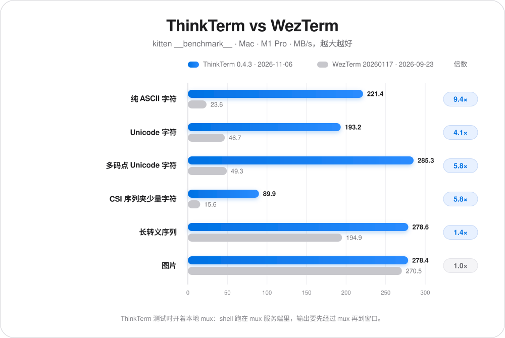
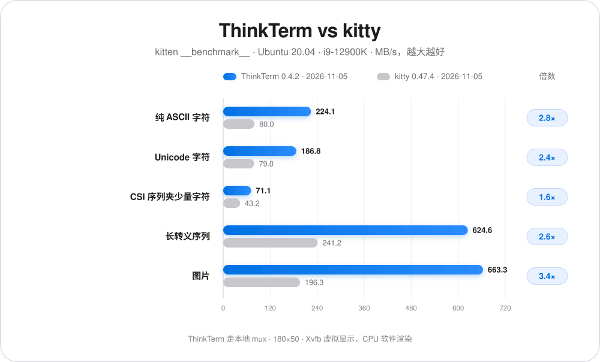
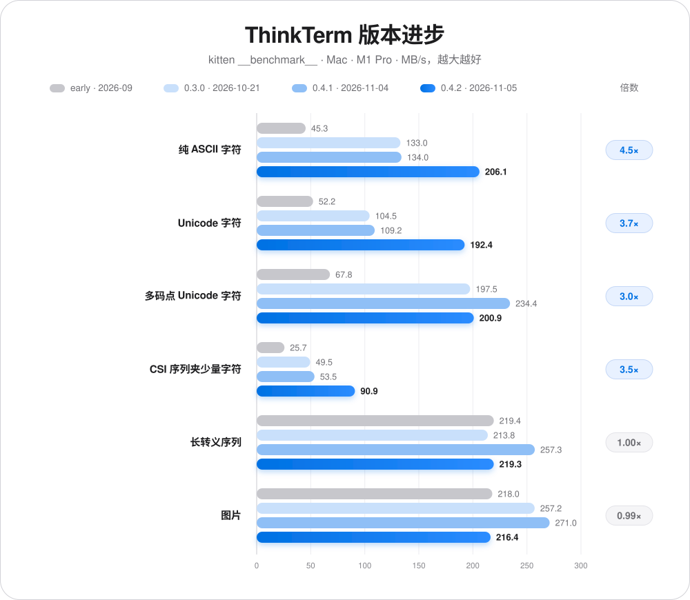
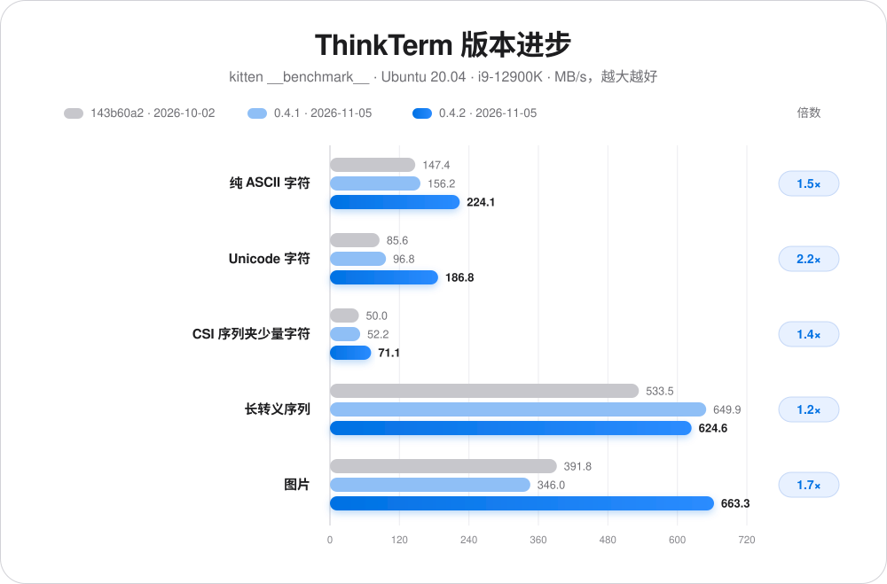

# ThinkTerm

[English](../README.md) · **简体中文** · [日本語](README.ja-JP.md) · [Français](README.fr-FR.md) · [Deutsch](README.de-DE.md)

## 📥 下载

**[点击下载](https://github.com/RoversX/ThinkTerm/releases)** - 获取最新版本

🍺 **Homebrew**（macOS）： 
```
brew install --cask roversx/tap/thinkterm
```

🌐 **官网**: [closex.org/thinkterm](https://closex.org/thinkterm/)

📚 **文档**: [docs.closex.org/thinkterm](https://docs.closex.org/thinkterm/)

⭐ 觉得有用的话，给 [ThinkTerm](https://github.com/RoversX/ThinkTerm) 点个 Star 吧！

**让你的多台机器融为一体。**

ThinkTerm 是一款**使用 Rust 编写、内置终端复用器的开源终端**，基于 [WezTerm](https://github.com/wezterm/wezterm) 构建。mux 服务端运行你的 Shell、工具和编程 Agent，桌面端、TUI 和浏览器端连接这些会话。你可以把本地与远程工作整理在同一个工作空间里，再从其他设备接入。

**平台支持：** macOS · Linux · Windows · Web · TUI — iOS 和 Android 开发中。

<table>
  <tr>
    <td width="50%" align="center">
      
      <br><strong>项目工作空间</strong>
    </td>
    <td width="50%" align="center">
      
      <br><strong>跨机器的 Agent</strong>
    </td>
  </tr>
  <tr>
    <td width="50%" align="center">
      
      <br><strong>会话总览</strong>
    </td>
    <td width="50%" align="center">
      
      <br><strong>空间切换</strong>
    </td>
  </tr>
</table>

## 以终端复用器为核心

<p align="center">
  <picture>
    <source media="(prefers-color-scheme: dark)" srcset="../assets/architecture-dark.svg">
    
  </picture>
</p>

终端复用器负责管理多个终端会话，并允许客户端接入。在 ThinkTerm 中，**会话、标签页和分屏由 mux 服务端持有**，客户端负责显示内容和传递输入。

- **断开后继续工作。** 客户端断开连接时，服务端持有的会话仍然运行。稍后重新连接，就能继续同一个 Shell、构建或 Agent 任务；主动关闭窗格是另一项操作。
- **从不同客户端访问同一批会话。** 桌面端、`thinkterm tui` 和浏览器端都可以连接服务端，也可以同时接入多个客户端，以各自的界面操作共享会话。
- **跨机器组织工作。** 每台主机运行自己的 mux 服务端。ThinkTerm Connect 将远程工作空间与本地工作放在同一个桌面界面中，通过侧边栏就能切换机器。进程始终在原来的主机上运行。
- **更新时会话不中断。** 桌面端为服务器更新 ThinkTerm 时，正在运行的 mux 服务端会把会话交接给新版本，Shell、构建和 Agent 都会继续运行。

会话持续运行的前提是 mux 服务端及其主机保持可用；这不意味着服务端或主机重启后能恢复原先运行的进程。

## 为什么做 ThinkTerm

同时在多个项目中运行 Agent 时，标签栏很快就会让人分不清：哪个还在工作，哪个需要输入，刚才的构建又在哪里结束了？ThinkTerm 把项目结构和工作状态放在终端旁边，让本地与远程工作一目了然。

Rust 支撑着 ThinkTerm 的终端核心、mux 服务端、桌面客户端和 TUI。桌面端通过 GPU 渲染，不依赖 Electron 或内嵌 WebView。Zed 的 UI 框架 GPUI 无法满足 ThinkTerm 在终端渲染上的性能要求。在 WezTerm 的原生基础之上，ThinkTerm 提供工作空间组织、持久远程会话和辅助 Agent 工作的工具。

## 性能

与 WezTerm 的吞吐对比，在同一台 Mac 上用 kitty 的 `kitten __benchmark__` 测得（MB/s，越大越好）。

ThinkTerm 测试时开着本地 mux：shell 跑在 mux 服务端里，输出要先经过 mux 再到窗口。

<p align="center">
  <picture>
    <source media="(prefers-color-scheme: dark)" srcset="../assets/performance-zh-CN-dark.svg">
    
  </picture>
</p>

<details>
<summary>表格数据</summary>

| 测试项 | ThinkTerm 0.4.2<br>2026-11-05 | WezTerm 20260117-154428-05343b38<br>2026-09-23 | 倍数 |
| --- | ---: | ---: | ---: |
| 纯 ASCII 字符 | **206.1** | 23.6 | 8.7× |
| Unicode 字符 | **192.4** | 46.7 | 4.1× |
| 多码点 Unicode 字符 | **200.9** | 49.3 | 4.1× |
| CSI 序列夹少量字符 | **90.9** | 15.6 | 5.8× |
| 长转义序列 | **219.3** | 194.9 | 1.1× |
| 图片 | 216.4 | **270.5** | 0.80× |

</details>

Linux 上与 kitty 对比：Ubuntu 20.04（i9-12900K），180×50，`TERM=xterm-256color`，在 Xvfb 虚拟显示里用 CPU 软件渲染。ThinkTerm 同样走本地 mux。

<p align="center">
  <picture>
    <source media="(prefers-color-scheme: dark)" srcset="../assets/performance-linux-zh-CN-dark.svg">
    
  </picture>
</p>

<details>
<summary>表格数据</summary>

| 测试项 | ThinkTerm 0.4.2<br>2026-11-05 | kitty 0.47.4<br>2026-11-05 | 倍数 |
| --- | ---: | ---: | ---: |
| 纯 ASCII 字符 | **224.1** | 80.0 | 2.8× |
| Unicode 字符 | **186.8** | 79.0 | 2.4× |
| CSI 序列夹少量字符 | **71.1** | 43.2 | 1.6× |
| 长转义序列 | **624.6** | 241.2 | 2.6× |
| 图片 | **663.3** | 196.3 | 3.4× |

</details>

同一台 Mac 上的版本进步。倍数是 0.4.2 相对早期版本。

<p align="center">
  <picture>
    <source media="(prefers-color-scheme: dark)" srcset="../assets/performance-progress-zh-CN-dark.svg">
    
  </picture>
</p>

<details>
<summary>表格数据</summary>

| 测试项 | ThinkTerm 早期<br>2026-09 | ThinkTerm 0.3.0<br>2026-10-21 | ThinkTerm 0.4.1<br>2026-11-04 | ThinkTerm 0.4.2<br>2026-11-05 | 倍数 |
| --- | ---: | ---: | ---: | ---: | ---: |
| 纯 ASCII 字符 | 45.3 | 133.0 | 134.0 | **206.1** | 4.5× |
| Unicode 字符 | 52.2 | 104.5 | 109.2 | **192.4** | 3.7× |
| 多码点 Unicode 字符 | 67.8 | 197.5 | 234.4 | **200.9** | 3.0× |
| CSI 序列夹少量字符 | 25.7 | 49.5 | 53.5 | **90.9** | 3.5× |
| 长转义序列 | 219.4 | 213.8 | 257.3 | **219.3** | 1.00× |
| 图片 | 218.0 | 257.2 | 271.0 | **216.4** | 0.99× |

</details>

同一套 Linux 环境上的版本进步。倍数是 0.4.2 相对 143b60a2。

<p align="center">
  <picture>
    <source media="(prefers-color-scheme: dark)" srcset="../assets/performance-linux-progress-zh-CN-dark.svg">
    
  </picture>
</p>

<details>
<summary>表格数据</summary>

| 测试项 | ThinkTerm 143b60a2<br>2026-10-02 | ThinkTerm 0.4.1<br>2026-11-05 | ThinkTerm 0.4.2<br>2026-11-05 | 倍数 |
| --- | ---: | ---: | ---: | ---: |
| 纯 ASCII 字符 | 147.4 | 156.2 | **224.1** | 1.5× |
| Unicode 字符 | 85.6 | 96.8 | **186.8** | 2.2× |
| CSI 序列夹少量字符 | 50.0 | 52.2 | **71.1** | 1.4× |
| 长转义序列 | 533.5 | 649.9 | **624.6** | 1.2× |
| 图片 | 391.8 | 346.0 | **663.3** | 1.7× |

</details>

## 围绕工作组织会话

| 层级 | 用途 |
| --- | --- |
| **Space（空间）** | 用于本地工作、远程 mux 连接或笔记 Vault 的工作环境。 |
| **Project（项目）** | 该环境中的项目目录。 |
| **Thread（线程）** | 包含标签页和分屏的会话，可以置顶或标记为未读。 |

本地与远程工作空间共用一个侧边栏。Thread 状态区分运行中、需要关注、已完成和空闲。总览按 Space 展示终端的实时预览，无需逐个打开标签就能找到会话。

## 面向日常终端工作

- **Rust、性能与内存效率。** ThinkTerm 面向高负载终端工作流，持续优化终端吞吐、渲染效率和内存占用，以多个会话与 Agent 并行工作时的流畅响应为目标。
- **Agent 状态。** Agents 面板集中展示识别到的编程 Agent、工作状态和所属项目。可以在设置中关闭 Agent 检测和该面板。
- **远程会话。** 可选择 SSH、Mosh，或通过 ThinkTerm Connect 使用持久 mux 会话。远程 mux 会话支持标签页、分屏、调整大小和重连；预测式本地回显可减轻高延迟连接下的输入迟滞感。服务器上还没有 ThinkTerm 时，连接时会询问是否以当前用户安装（无需 root）；版本不一致时会提供对应的版本。
- **内置 Tailscale。** 无需安装 Tailscale 客户端，就能在 ThinkTerm 中加入 tailnet 并连接其中的机器；它们会和已保存的服务器一起列在远程主机页中。支持 macOS 和 Linux。
- **终端旁的文件。** 浏览项目文件，预览带语法高亮的源码，并用外部编辑器打开。远程文件通过 SFTP 访问，支持上传、下载和拖放传输。
- **笔记。** 在兼容 Obsidian 的 Vault 中编辑 Markdown，支持表格、代码块和自动保存。文件仍是普通 Markdown，存放在你选择的目录中。
- **片段与插件。** 内置 Snippets。插件可向桌面端和浏览器端添加侧边栏面板；仓库中包含 [Diff 插件](../plugins/diff)，用于查看旁边终端所在 Git 仓库的改动。你也可以使用 [ThinkTerm SDK](../docs/thinkterm/plugins.md#rust-sdk)，用 Rust 开发自己的插件。别人分享的插件可以在 GitHub 话题 [`thinkterm-plugin`](https://github.com/topics/thinkterm-plugin) 下找到。安装和开发方式见[插件指南](../docs/thinkterm/plugins.md)。
- **完整的终端核心。** 字体连字、彩色 Emoji、真彩色、超链接、内嵌图片、复制模式和 Shell 集成均继承自 WezTerm。 更多终端特性可参考 [WezTerm 功能文档](https://wezterm.org/features.html)。
- **原生桌面设置。** 调整主题、界面字号、终端选项和渲染后端。主窗口与设置窗口均支持 WebGPU 和 OpenGL；WebGPU 初始化失败时会回退到 OpenGL。
- **五种界面语言。** English、简体中文、日本語、Français 和 Deutsch。

CLI 也支持自动化操作窗格：`thinkterm cli send-text` 发送输入，`send-key` 发送按键，`get-text` 读取终端输出，`wait` 和 `events` 会在命令结束或窗格发生变化时告知。用 `set-pane-label` 给窗格命名后，就可以按名字指定窗格。Agent 可以借助这些命令通过终端交互。[协作说明](../docs/thinkterm/agent-collaboration.md) 记录了已演示的工作流程，以及将终端输入用作消息机制的局限。

## 选择连接方式

| 客户端 | 当前范围 |
| --- | --- |
| **桌面端** | 面向 macOS、Linux 和 Windows 的原生应用。 |
| **TUI** | 通过 `thinkterm tui`，在已有终端中浏览工作空间并操作终端会话。 |
| **浏览器端** | 由你自己的 mux 服务端提供；需要 WebGPU 和浏览器安全上下文。必须主动启用浏览器访问。 |
| **iOS 和 Android** | 开发中的原生客户端，共享 Rust 核心，使用 GPU 渲染和 SSH 传输。移动端的发布准备与设备覆盖仍在完善。 |

这些客户端连接服务端持有的会话，但界面和功能覆盖范围有所不同。

### 终端界面

```sh
thinkterm tui
thinkterm tui --help
```

TUI 支持工作空间导航、标签页、分屏、调整大小、复制模式和鼠标输入。退出只会断开连接，不会关闭服务端会话。请在独立终端中运行；在 ThinkTerm 自身的会话内启动可能触发嵌套保护。

### 浏览器访问

在 **Settings → Web（设置 → Web）** 中启用监听，然后为浏览器创建访问令牌。mux 服务端提供客户端页面及其资源。默认情况下，非回环连接需要 HTTPS；浏览器也需要安全上下文才能使用 WebGPU。

监听配置、令牌、SSH 转发和证书处理方式见[浏览器访问](../docs/thinkterm/web-access.md)。

### 移动端开发

[iOS](../ios) 和 [Android](../android) 应用采用原生界面，共享[移动端核心](../thinkterm-mobile)，通过 SSH 连接另一台机器上的会话。它们仍在积极开发中，目前不作为已发布的移动产品介绍。

## 开始使用

在 macOS 或 Linux 上构建桌面端，请先安装 Rust 和平台构建工具，然后执行：

```sh
git clone --recursive https://github.com/RoversX/ThinkTerm.git
cd ThinkTerm
./get-deps
cargo build --release -p wezterm -p wezterm-gui -p wezterm-mux-server -p thinkterm-plugin-server -p thinkterm-tailnet-node
```

生成的可执行文件位于 `target/release`。源码结构和开发流程见[贡献指南](../CONTRIBUTING.md)。[浏览器构建脚本](../ci/build-web.sh) 用于构建独立的 Web 资源；移动端构建入口为 [ios/build.sh](../ios/build.sh) 和 [android/build.sh](../android/build.sh)。

将可执行文件加入 `PATH` 后：

```sh
thinkterm start              # 打开桌面应用
thinkterm tui                # 打开终端界面
thinkterm connect <name>     # 连接已配置的 mux 域
thinkterm cli --help         # 查看和控制 mux 会话
thinkterm plugin list        # 列出可用插件
thinkterm --help             # 查看所有命令
```

### 让编程 Agent 使用 ThinkTerm

仓库里附带一个 skill，教 Claude Code、Codex、Cursor 等编程 Agent 查看和操作其他窗格。安装：

```sh
npx skills add RoversX/ThinkTerm --skill thinkterm -g
```

## 文档与开发

- [浏览器访问](../docs/thinkterm/web-access.md)
- [插件](../docs/thinkterm/plugins.md)
- [参与贡献](../CONTRIBUTING.md)

## 配置与隐私

ThinkTerm 使用 Lua 配置，默认读取自己的 ThinkTerm 路径，并支持许多 WezTerm 配置选项。**Settings → Compatibility（设置 → 兼容性）** 可以从已有 WezTerm 配置中导入选定字段。也可以通过 `THINKTERM_CONFIG_FILE` 或兼容变量 `WEZTERM_CONFIG_FILE` 等显式文件覆盖方式选择其他文件。

### ThinkTerm 不使用任何遥测或跟踪器

设置 `check_for_updates = false` 可关闭更新检查。远程连接、笔记图片加载等功能在使用时会发起网络请求；设置 `note_remote_images_enabled = false` 可关闭笔记中的远程图片。

桌面端 SSH 主机簿使用本地保存的密钥加密密码。任何同时持有密钥和加密主机数据的人都可以解密密码，包括从备份中获得两者的情况。浏览器访问令牌可用于访问服务端终端会话，应作为凭据保管。

隐私政策和浏览器数据处理方式见 [PRIVACY.md](../PRIVACY.md)。

## 致谢

- 感谢 **[@wez](https://github.com/wez/) 和 [WezTerm](https://github.com/wezterm/wezterm) 的贡献者**，为 ThinkTerm 提供终端核心与复用器基础，包括终端仿真、字体和 GPU 渲染，以及 SSH 支持。
- 感谢 **[herdr](https://github.com/herdrdev/herdr) 的贡献者**，提供 ThinkTerm 使用的 Agent 检测清单。
- 感谢 **Lucide、Simple Icons、Lobe Icons 和 material-icon-theme**，提供图标资源。
- 感谢所有为 **ThinkTerm** 贡献代码、翻译、测试、问题报告和使用反馈的参与者。

欢迎贡献。提交 Pull Request 前请阅读 [CONTRIBUTING.md](../CONTRIBUTING.md)。

## 许可证

ThinkTerm 采用 **GPL-3.0-only** 许可证，见 [LICENSE.md](../LICENSE.md)。来自 WezTerm 的代码保留其原有 MIT 许可证，见 [LICENSE-MIT](../LICENSE-MIT)。来自 herdr 的 Agent 检测清单采用 **Apache-2.0** 许可证。

第三方组件与附带资源的完整署名及许可证见 [NOTICE](../NOTICE) 和 [licenses/README.md](../licenses/README.md)。


